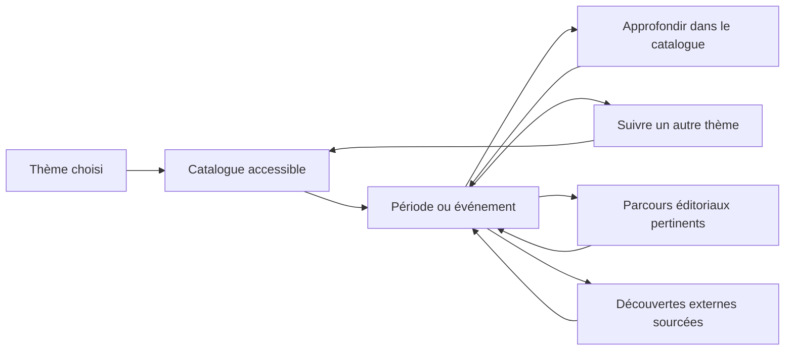

# Audit UX — exploration de UniversalTimeline

30 octobre 2026 — audit de la frise locale, des parcours Stories et du code en place. Périmètre confirmé : exploration du catalogue **et découvertes externes**, notamment Wikidata. Document de décision ; les comportements proposés ne sont pas encore implémentés.

## Mise à jour après audit — UI09, 30 octobre

Le défaut de transmission des catégories identifié en UX03 est corrigé. La liste de story renvoie les catégories de ses événements ; Eukaryota et Explosion cambrienne se mettent désormais mutuellement en évidence. Vérification locale : 14 événements catégorisés sur 14, et 862 tests réussis. Les constats ci-dessous décrivent l’état observé lors de l’audit initial. Les autres recommandations, dont la navigation par catégories UX04, restent ouvertes.

## Diagnostic

L’expérience actuelle propose surtout une descente dans un parcours prédéfini. Elle fonctionne pour suivre ce parcours, puis rend difficile un changement de sujet, l’accès à une autre story ou la poursuite au-delà de sa sélection. Les stories définissent actuellement les limites des données chargées et les seules passerelles de continuation. Le besoin exprimé demande trois déplacements accessibles : approfondir une période, suivre un thème et bifurquer vers un autre parcours.

La question précédente « masquer ou atténuer les autres catégories » couvrait seulement la présentation. Le rôle attendu des catégories est aussi de proposer des destinations d’exploration.

## Méthode et limites

- Lecture des composants de la frise, de la navigation, de la recherche, du catalogue et des suggestions de stories.
- Recette réelle sur Terre : clic Hadéen, sélection de Premières traces de vie, passage à Stories et consultation de la story géologique.
- Lectures anonymes via l’API locale des 11 stories publiques, de leurs détails et des 18 catégories. Comparaison des catégories du détail et de la réponse utilisée par la frise.
- Analyse du graphe déclaré des stories et des ancres. Les chiffres ci-dessous concernent ce jeu public à la date de l’audit, sans prétendre décrire des contenus privés ou toute la couverture de Wikidata.
- Audit expert, sans séance d’observation avec de nouveaux utilisateurs, test mobile exhaustif ou certification d’accessibilité. Les problèmes d’orientation et les préférences de présentation restent à confirmer par une recette utilisateur.

Aucune donnée ni configuration distante modifiée, aucune story reliée automatiquement et aucun code applicatif changé pendant cet audit. Les 858 tests du lot précédent restent un résultat historique ; pas de nouvelle suite exécutée pour ce travail documentaire.

## Constats prioritaires

| ID | Priorité | Constat et preuve | Conséquence pour l’utilisateur | Direction proposée |
|---|---|---|---|---|
| UX01 | P1 | `childrenOf` recalcule les enfants sur les seules périodes de la story ; les événements sont eux aussi limités à cette story. Archéen, Protérozoïque et Phanérozoïque sont des feuilles dans Univers moderne, alors que leurs enfants sont présents dans d’autres stories publiques : respectivement 4, 3 et 3 enfants directs connus. | La fin du parcours ressemble à la fin du contenu disponible. | Donner accès aux enfants du catalogue et distinguer clairement leur provenance de ceux du parcours guidé. |
| UX02 | P1 | Les suggestions exigent une story enfant **et** une ancre correspondante. Histoire de la vie sur terre et Histoire géologique de la terre sont enfants d’Univers moderne avec zéro ancre. Le graphe d’ancres permet théoriquement d’atteindre seulement **2 stories sur 11, entrée comprise**, depuis Univers moderne. | Du contenu déjà renseigné reste absent des continuations de la frise. | Montrer les parcours disponibles indépendamment des ancres. Conserver les ancres comme recommandations éditoriales prioritaires. Réparer les liens existants peut dépanner, mais ne suffit pas à ouvrir le catalogue. |
| UX03 | P1 | Les 14 événements d’Univers moderne ont des catégories dans le détail de story. Aucun des 14 enregistrements de `/stories/1/events` ne contient le champ categories. Le mapping produit une liste vide. Sur la session observée, sélectionner Premières traces de vie ne met aucun autre événement en évidence. | Même la relation visuelle prévue par les catégories peut disparaître selon les données chargées. | Réparer le contrat de lecture et la conservation des métadonnées avant d’en faire un mécanisme de navigation. |
| UX04 | P1 | La fiche d’événement donne le titre, la date et les stories liées, sans afficher de catégories cliquables. Les 18 catégories du catalogue existent, mais les 11 stories publiques n’ont aucune catégorie explicite. | Impossible de comprendre le thème d’un événement puis de le suivre ; un sélecteur filtrant seulement les stories par leurs catégories explicites serait vide. | Afficher les thèmes sur les événements ; proposer des destinations dans le catalogue. Pour les stories, combiner à terme catégories éditoriales et rapprochements expliqués par leurs éléments. |
| UX05 | P1 | La frise n’a pas de choix direct de story. La page Stories est une interface de gestion, sans action de lancement dans la frise. La recherche conduit vers Periods/Events ; ces pages demandent un compte, selon les règles actuelles. | Changer de sujet oblige à quitter le parcours de lecture ; un visiteur public n’a pas cette voie de découverte. | Ajouter dans la timeline un accès de lecture aux parcours publics et accessibles. Garder les actions de création/édition dans l’espace de gestion. |
| UX06 | P1 | Cliquer une période feuille produit trois comportements : aucun résultat visible, changement automatique de story s’il y a une seule suggestion, ou menu s’il y en a plusieurs. Hadéen n’a donné aucune continuation visible. Un événement sans suggestion affiche seulement « Aucune story liée ». | Le même geste a des effets imprévisibles ; une absence de lien éditorial est perçue comme une impasse. | Présenter systématiquement les destinations disponibles et laisser l’utilisateur choisir. Distinguer approfondissement, autre parcours, même thème et recherche externe. |
| UX07 | P2 | Les détails d’événement sont dans une petite bulle ; un second contrôle développe ensuite les stories. Les catégories sont exprimées par une couleur partagée, sans explication textuelle. | Les liens intéressants sont cachés derrière plusieurs interactions et leur raison reste floue. | Une fiche de lecture stable, compacte ou latérale selon l’espace, avec date, description, thèmes et actions nommées. La couleur complète les libellés. |
| UX08 | P2 | Le fil d’Ariane représente le contexte hiérarchique. Les changements de période/story restent en mémoire et ne sont pas encodés dans l’URL `/timeline`. | Les changements de thème et les allers-retours transversaux auront besoin d’une mémoire supplémentaire ; rechargement et partage ne restaurent pas le point exploré. | Distinguer hiérarchie et historique de visite. Prévoir précédent/suivant et une URL restaurant au minimum parcours, période ou événement, thème et fenêtre temporelle. |
| UX09 | P2 | Dans la vue Terre, plusieurs événements récents se concentrent au bord droit. L’axe n’a pas de graduations ; l’agrandissement au survol modifie temporairement la projection. | Un changement de thème vers l’histoire humaine peut laisser les résultats illisibles dans une fenêtre de plusieurs milliards d’années. | Préserver d’abord le contexte temporel, proposer un cadrage explicite des résultats, des repères d’échelle et des regroupements aux fortes densités. Ne pas confondre agrandissement de lecture et zoom temporel. |
| UX10 | P2, requis avant l’ouverture externe | Le finder Periods sait déjà chercher certains enfants Wikidata, mais ce mécanisme n’est pas utilisé par la frise. Le service de résumés d’enfants remplace encore une fin absente par TODAY. | La découverte externe n’est pas une continuation actuelle ; la réutilisation sans revue peut afficher une période jusqu’à aujourd’hui faute de borne. | Charger progressivement des propositions sourcées, avec dates inconnues explicites, limites, dédoublonnage et reprise en cas d’échec. Aucune importation implicite dans une story. |

P1 = empêche directement la découverte demandée. P2 = rend le futur parcours compréhensible et fiable. Ces priorités portent sur l’UX et le fonctionnement observé, pas sur une nouvelle classification de sécurité.

## Modèle d’exploration proposé

Le **catalogue partagé** fournit les périodes et événements ; les **catégories** donnent des angles de découverte ; les **stories** apportent un parcours éditorial avec un périmètre annoncé ; les **sources externes** proposent une suite lorsque l’on souhaite aller plus loin.

### Deux cadres lisibles

| Cadre | Promesse | Sortie possible |
|---|---|---|
| Exploration libre | Parcourir les contenus accessibles, avec un thème et une fenêtre temporelle ; aucune connexion manuelle entre stories exigée. | Ouvrir un parcours pertinent ou demander des découvertes externes. |
| Parcours guidé | Suivre la sélection d’une story clairement nommée, avec son contexte éditorial. | « Continuer en exploration libre » au même point temporel ou choisir un autre parcours. |

Un accès direct à l’exploration libre doit être permanent. Le parcours actuel peut rester l’accueil initial pendant la transition ; le choix du futur accueil fera l’objet de la recette. Les stories privées restent visibles seulement pour les personnes autorisées ; ouvrir la découverte ne demande pas d’assouplir leurs droits.

### Rôle du sélecteur de catégorie

Libellé proposé : **Thème**, avec une entrée **Tous les thèmes**. Commencer par un thème à la fois évite une règle OU/ET prématurée.

- Changer de thème conserve la période ou la fenêtre temporelle tant qu’elle est pertinente. La catégorie ne devient pas un nouvel intervalle de dates.
- Dans l’exploration libre, les résultats viennent du catalogue accessible, au-delà de la story d’origine.
- Dans une story guidée, le périmètre reste explicite : « Dans ce parcours ». Un accès « Explorer ce thème au-delà du parcours » mène à l’exploration libre au même point. Éviter de mélanger silencieusement une story sélectionnée et des résultats extérieurs.
- Les catégories de la fiche d’événement sont des actions : « Explorer la biologie évolutive à cette époque », par exemple.
- Garder les repères de périodes nécessaires pour se situer ; privilégier les événements du thème et proposer les autres thèmes sans imposer tous leurs marqueurs à pleine intensité.
- Aucun résultat dans la fenêtre : expliquer cette portée et proposer d’élargir les dates ou d’aller au résultat le plus proche. Aucun déplacement temporel silencieux.
- Les rapprochements de stories peuvent s’appuyer sur les entités partagées, les catégories de leurs éléments et le recouvrement temporel. Afficher la raison du lien. Une correspondance automatique n’est pas une classification éditoriale validée.

Le choix visuel entre masquer et atténuer peut être testé ensuite sur des cas denses. Il ne doit pas décider à lui seul de la portée de l’exploration.

### Un événement comme carrefour

Exemple : **Premières traces de vie**.

1. Lire le nom, la date et une description quand elle existe.
2. Voir ses thèmes : Biologie évolutive et Microbiologie, d’après les données observées.
3. Approfondir les éléments accessibles de cette époque et de ces thèmes.
4. Voir les parcours pertinents, dont Histoire de la vie sur terre si le rapprochement est justifié, même sans ancre manuelle.
5. Demander des découvertes externes si l’on veut poursuivre.
6. Revenir à Terre avec le thème et le cadrage antérieurs.

La proposition ne prétend pas que ces liens supplémentaires existent déjà dans l’interface.

### Découverte externe progressive

L’objectif « infini » signifie pouvoir poursuivre la recherche sans dépendre du maillage manuel des stories. Cela ne garantit pas des résultats à toute profondeur.

- Une action explicite demande la suite pour une entité, un thème et un contexte temporel ; chargement limité et progressif.
- Les propositions indiquent leur source et leur statut externe. Une absence de date reste inconnue ; ne pas la transformer en présent.
- Distinguer aucun résultat, limite de résultats, source indisponible et données impossibles à placer sur l’axe. Donner une reprise ou une autre direction.
- Dédupliquer les entités locales/externes à partir des identifiants canoniques et éviter les boucles de parcours.
- Consulter une proposition ne crée pas automatiquement un enregistrement local ou une association à une story. La composition d’un parcours reste une action distincte dans l’espace utilisateur.
- Le service Wikidata existant constitue un point de départ pour certaines relations temporelles. Il faudra définir et vérifier les relations de découverte par domaine ; une liste d’enfants de périodes ne couvre pas tous les sujets de la timeline.

## Ordre de réalisation recommandé

| Lot | Résultat reviewable | Critères d’acceptation |
|---|---|---|
| UX-A — Ouvrir les parcours existants | Contrat de catégories rétabli, choix de story dans la timeline, destinations toujours explicites et sortie des impasses. | Depuis Terre, ouvrir la story géologique ou la story de la vie sans passer par l’éditeur et sans ancre préalable ; une destination unique n’entraîne plus de bascule automatique. |
| UX-B — Exploration libre et thèmes | Enfants du catalogue hors sélection d’une story, sélecteur Thème et thèmes cliquables dans une fiche stable. | Depuis Archéen dans Univers moderne, trouver ses quatre enfants connus ; changer de thème sans perdre ses repères ; voir une explication si la fenêtre ne contient aucun résultat. |
| UX-C — Retours et densité | État restaurable, historique, repères temporels et traitement des événements regroupés. | Revenir après une bifurcation au même thème et cadrage ; restaurer un lien partagé après rechargement ; distinguer une concentration de marqueurs d’un événement unique. |
| UX-D — Sources externes | Propositions Wikidata accessibles depuis l’exploration libre, sourcées et progressives. | Tester résultat local+externe identique, borne absente, erreur réseau, aucun résultat et parcours répétitif ; aucune importation ou association implicite. |

Chaque lot doit être montré et testé comme un parcours complet. Préparer une maquette de navigation pour UX-A/UX-B avant de modifier l’ensemble de la frise permettra de vérifier le modèle avec l’utilisateur.

## Recette utilisateur à préparer

- « Je suis sur Terre, je veux suivre l’apparition de la vie. »
- « Je suis dans l’histoire de la vie, je veux explorer la géologie à la même époque. »
- « Je connais le nom d’une story ; je veux l’ouvrir directement dans la frise. »
- « Ce parcours s’arrête, je veux voir les sous-périodes déjà présentes ailleurs. »
- « Le catalogue s’arrête aussi, je veux chercher une suite externe. »
- « Je me suis éloigné ; je veux revenir et partager le point où j’étais. »

Observer la compréhension du périmètre, les actions nécessaires, les impasses et la capacité à revenir. Ne pas évaluer uniquement la fluidité des animations.

## Références dans le code actuel

| Référence | Point constaté |
|---|---|
| `src/composables/useHomeNavigation.ts:53` et `:114` | Périmètre story, clic feuille et bascule automatique avec une suggestion. |
| `src/lib/homeStoryPeriodNav.ts:9` | Enfants et hasChildren recalculés dans la sélection de story. |
| `server/src/repositories/storyRepository.ts:86` | Réponse événements de story sans agrégation des catégories. |
| `server/src/repositories/storyRepository.ts:157` | Suggestions limitées au parent et aux ancres. |
| `src/views/HomeView/PeriodGrid.vue:155` et `:383` | Suggestions événement et mise en évidence des catégories locales. |
| `src/views/HomeView/EventCard.vue:20` | Contenu actuel de la fiche et message Aucune story liée. |
| `src/views/DatabaseView/DatabaseView.vue:1` | Parcours de gestion des stories. |
| `src/router/searchTarget.ts:21` et `src/router/routes.ts:6` | Destination des recherches et séparation des routes publiques/compte. |
| `src/composables/useGraphView.ts:143` | Extension Wikidata présente dans le finder du catalogue. |
| `src/services/WikidataQueryService.ts:148` | Résumés d’enfants externes et fin absente remplacée par TODAY. |

Preuves locales : `.tmp/ux-audit-20261030/public-catalog.json`, `story-graph.json`, `diagnostic.json`, `metrics.json` et captures. Le graphe mesure l’accessibilité théorique par les ancres du mécanisme actuel, pas l’existence de toute voie de consultation du contenu.
