# Userflows — exploration de UniversalTimeline

Complément de `AUDIT-UX-EXPLORATION.md` (30 octobre 2026). Les parcours **existants** décrivent le comportement constaté pendant l'audit ; les parcours **proposés** sont des décisions de conception, non implémentées. Les identifiants UXnn renvoient aux constats de l'audit.

Légende : rouge = impasse ou comportement imprévisible ; vert = destination ouverte par la proposition ; pointillé = lien proposé non encore existant.

---

## Partie 1 — Parcours existants

### E1. Cliquer une période (feuille ou non) — UX01, UX02, UX06

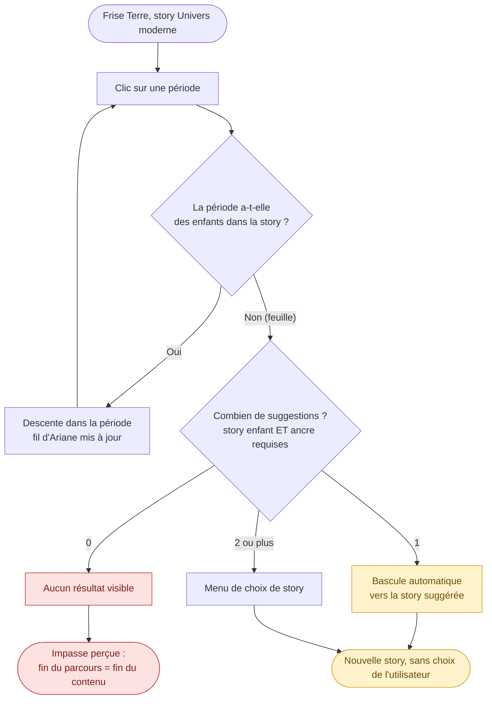

Constat : le même geste produit trois effets (rien, bascule, menu). Hadéen n'ouvre aucune continuation. Archéen, Protérozoïque et Phanérozoïque sont des feuilles alors que leurs enfants (4, 3, 3) existent dans d'autres stories.

### E2. Cliquer un événement — UX03, UX04, UX07

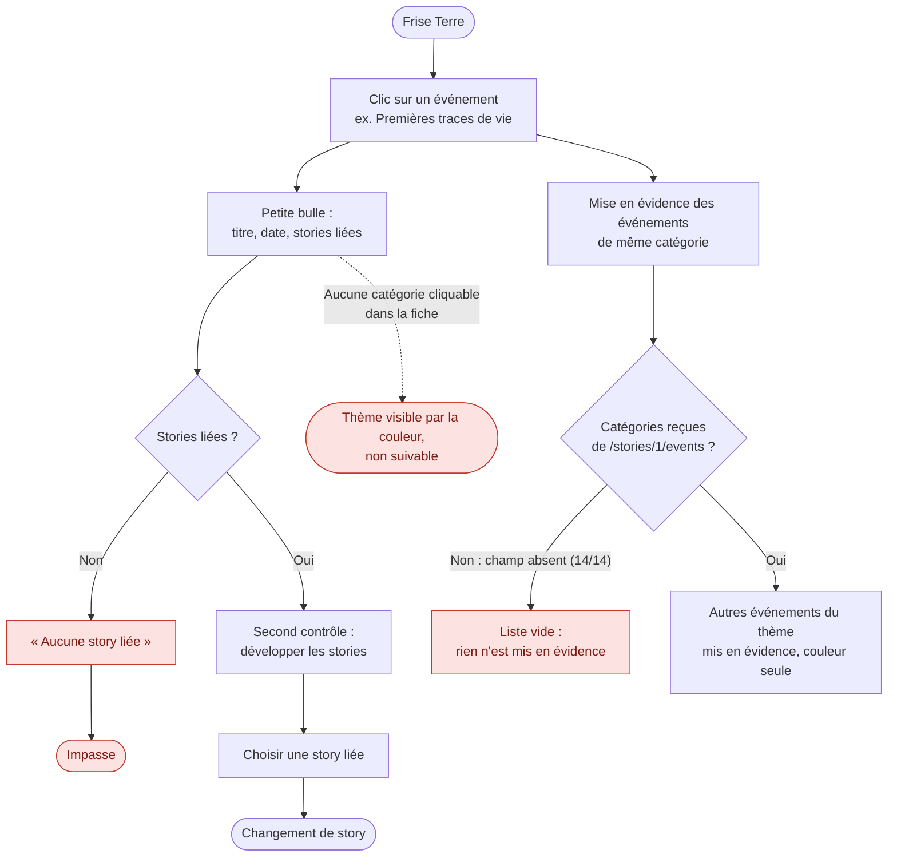

### E3. Changer de sujet ou de story — UX05

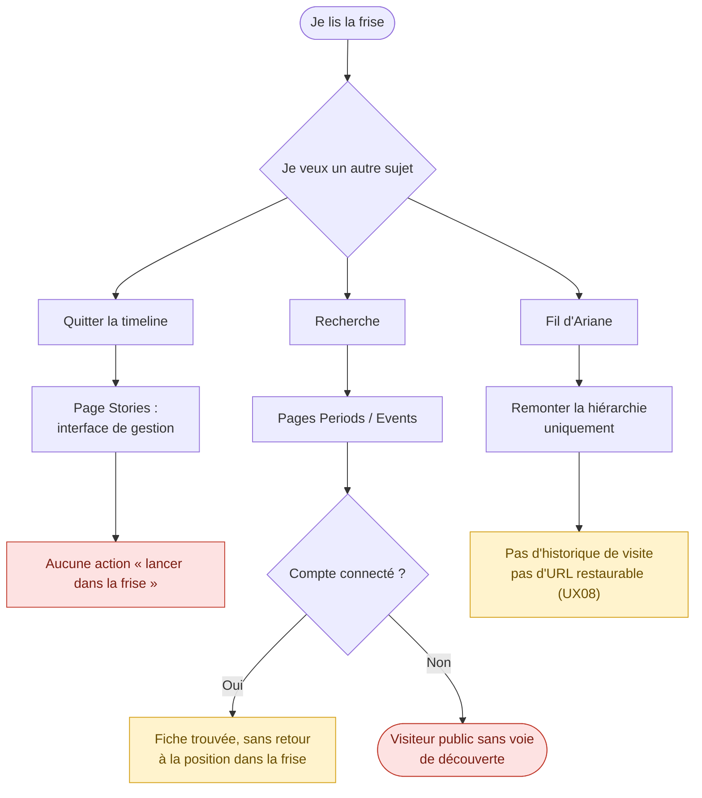

### E4. Vue d'ensemble de l'existant

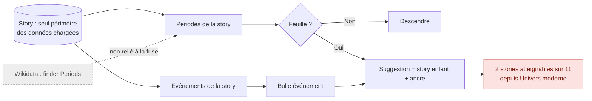

---

## Partie 2 — Parcours proposés

### P1. Modèle global : deux cadres, un carrefour — modèle d'exploration

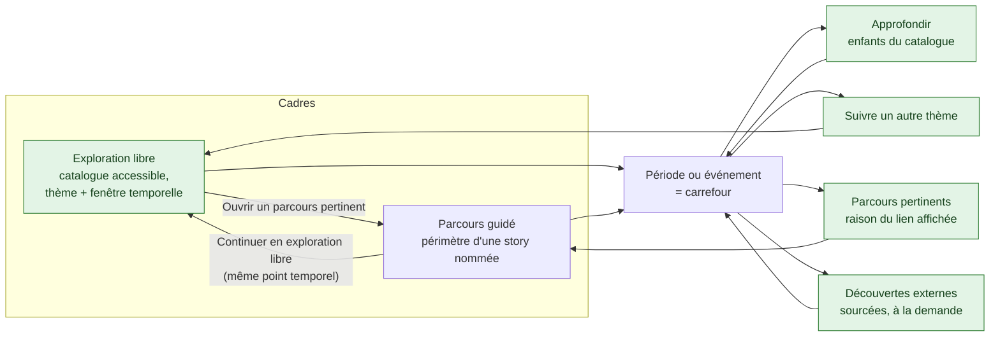

Accès direct à l'exploration libre permanent ; le parcours actuel reste l'accueil pendant la transition (choix final à valider en recette).

### P2. Cliquer une période — destinations toujours explicites (UX01, UX02, UX06)

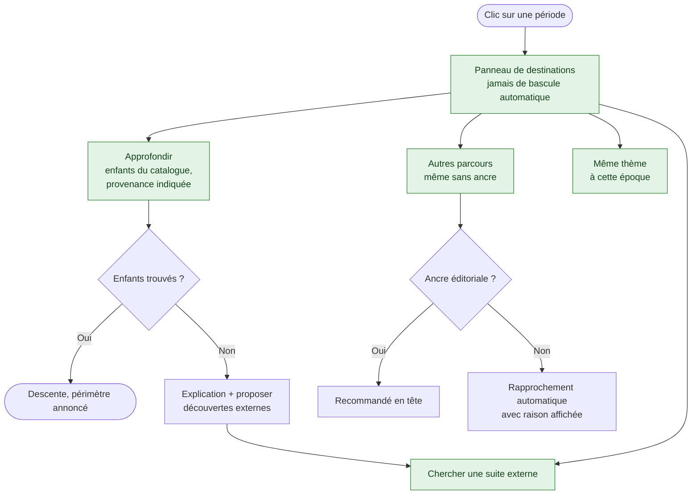

Exemple de recette : depuis Archéen dans Univers moderne, retrouver ses 4 enfants connus.

### P3. Fiche d'événement stable et thèmes cliquables — UX04, UX07

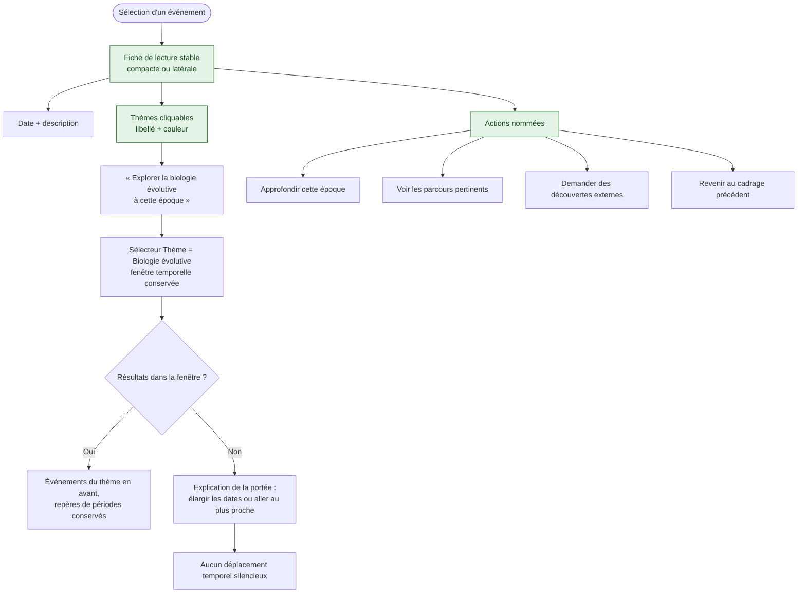

### P4. Sélecteur Thème selon le cadre — rôle du sélecteur de catégorie

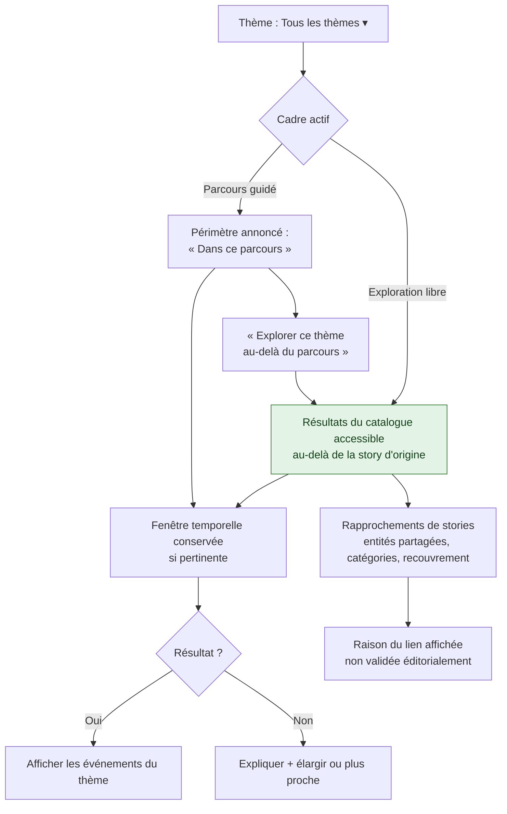

### P5. Choisir un parcours depuis la frise — UX05

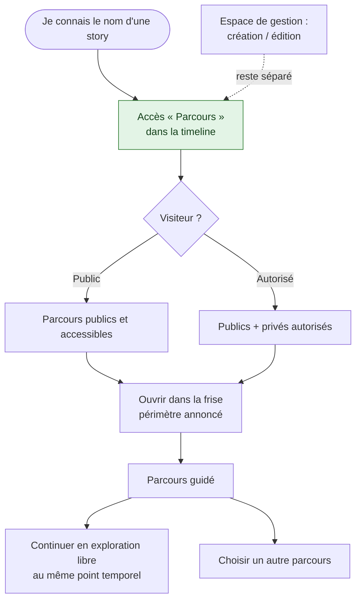

### P6. Découverte externe progressive (Wikidata) — UX10

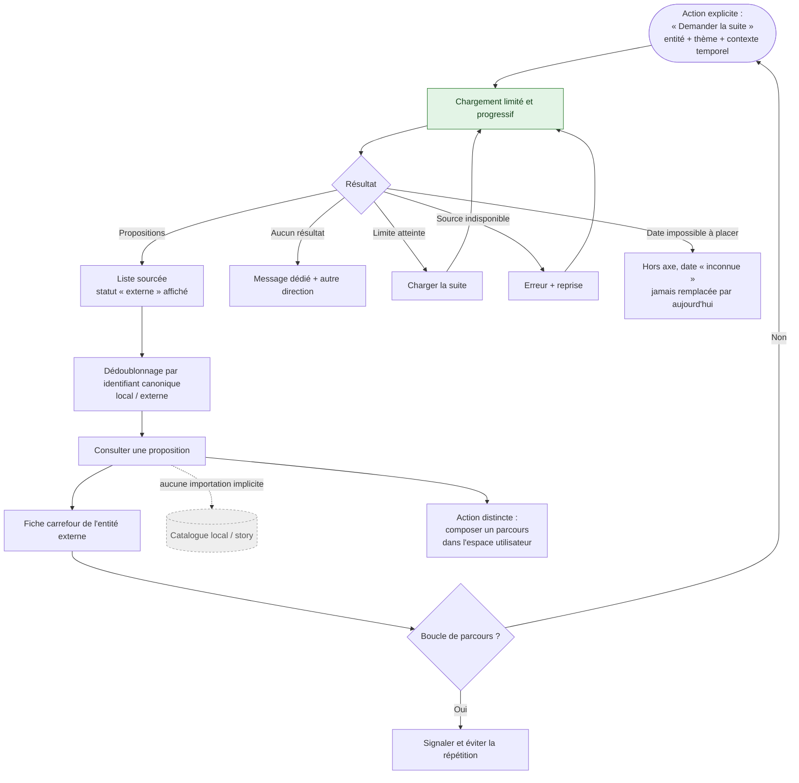

### P7. Retour, historique et partage — UX08, UX09

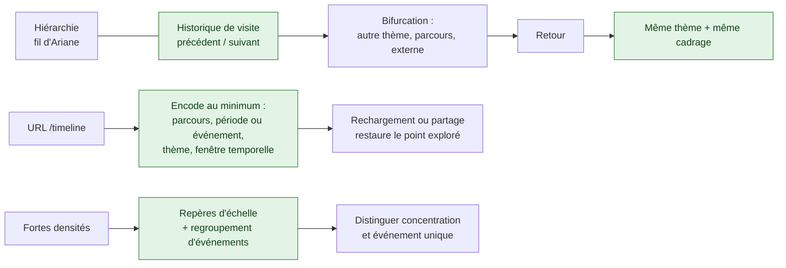

### P8. Scénario complet : « Je suis sur Terre, je veux suivre l'apparition de la vie »

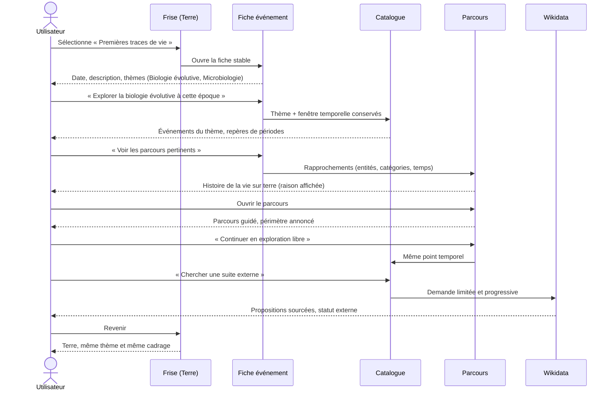

---

## Correspondance flux ↔ lots de réalisation

| Flux | Constats | Lot |
|---|---|---|
| P5, P2 (destinations), E1/E3 corrigés | UX02, UX05, UX06, UX03 | UX-A |
| P2 (approfondir), P3, P4 | UX01, UX04, UX07 | UX-B |
| P7 | UX08, UX09 | UX-C |
| P6 | UX10 | UX-D |
