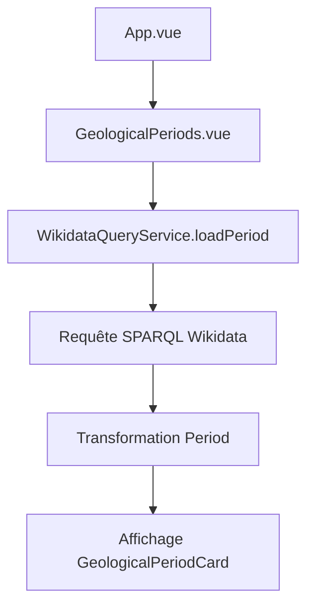
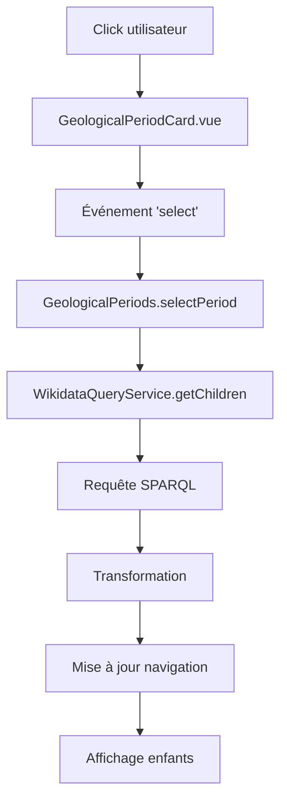
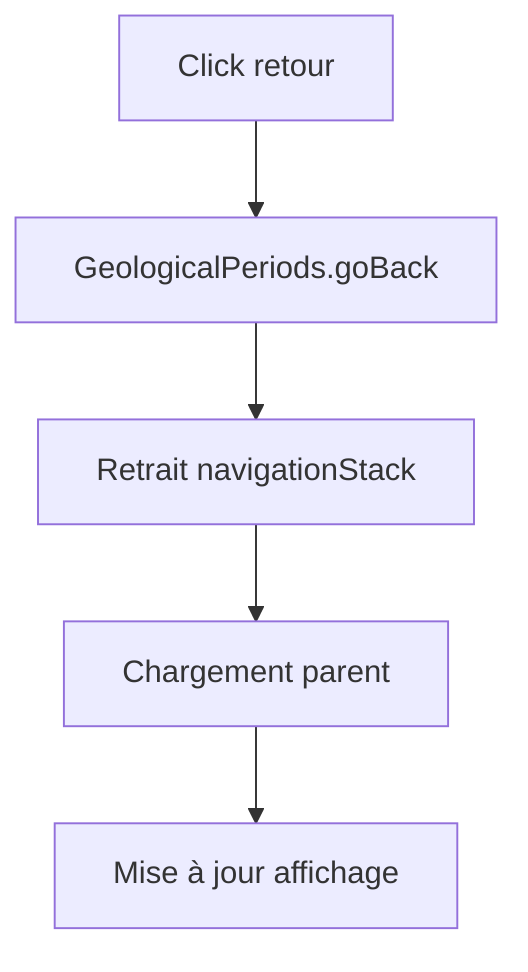
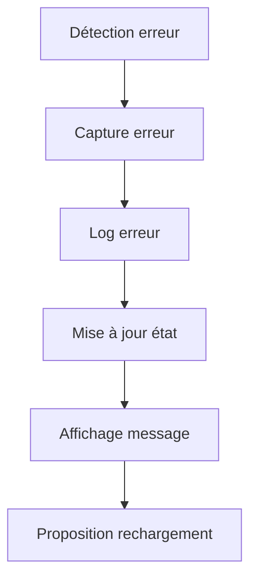
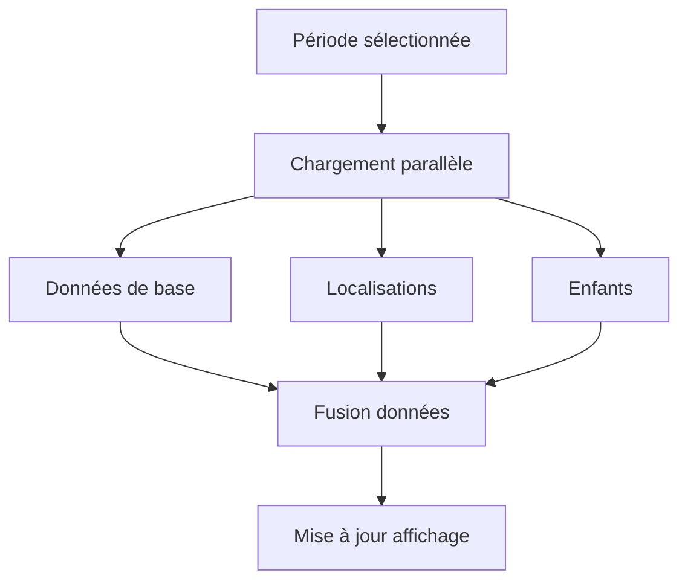
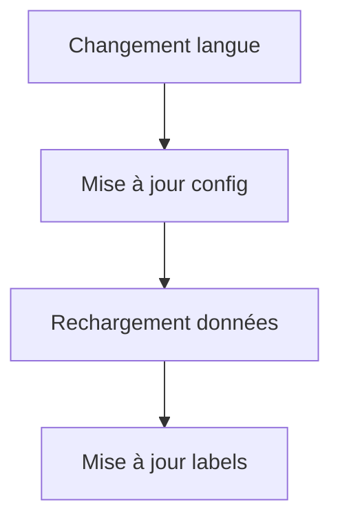

# Documentation des Flux de Données

## Table des matières
1. [Flux de démarrage](#flux-de-démarrage)
2. [Flux de navigation](#flux-de-navigation)
3. [Flux de gestion des erreurs](#flux-de-gestion-des-erreurs)
4. [Flux de chargement des détails](#flux-de-chargement-des-détails)
5. [Flux de gestion de la langue](#flux-de-gestion-de-la-langue)
6. [Optimisations](#optimisations)

## Flux de démarrage



1. App.vue se charge
2. GeologicalPeriods.vue est initialisé
3. WikidataQueryService.loadPeriod() est appelé
4. Requête SPARQL à Wikidata
5. Transformation des données en Period[]
6. Affichage des éons dans GeologicalPeriodCard[]

## Flux de navigation

### Clic sur une période


### Navigation arrière


## Flux de gestion des erreurs



## Flux de chargement des détails



## Flux de gestion de la langue



## Optimisations

### Chargement Progressif
- Observation des éléments visibles
- Gestion des états de chargement
- Préchargement intelligent

### Gestion des Erreurs
- Retries automatiques (max 3)
- Messages d'erreur explicites
- Possibilité de rechargement
- Logs détaillés

### Performance
- Requêtes parallèles
- Chargement à la demande
- Gestion de la mémoire
- Timeout de 30 secondes

## Notes techniques

### Types de données principaux
```typescript
interface Period {
  id: string;              // Identifiant Wikidata
  label: string;           // Nom de la période
  temporalData: TemporalLocation[]; // Données temporelles avec localisations
  hasChildren: boolean;    // Indique si la période a des sous-périodes
  isMainEon: boolean;      // Indique si c'est un éon principal
  categoryIds: string[];   // IDs des catégories
  categoryLabels: string[]; // Labels des catégories
  children: Period[];      // Liste des périodes enfants
  loading: boolean;        // État de chargement
  childrenPreloaded: boolean; // État de préchargement des enfants
  locations: string[];     // Liste des localisations
  directLocations: string[]; // Localisations directes
}

interface TemporalLocation {
  startDate?: string;      // Date de début formatée
  endDate?: string;        // Date de fin formatée
  location: string;        // Localisation associée
}
```

### Services clés
- WikidataQueryService : Gestion des données et requêtes SPARQL
- DatabaseQueryService : Gestion des données de la base de données locale
- TimelineScalingService : Calcul des positions et dimensions des périodes
- StoryService : Gestion des stories géologiques
- DatabaseService : Opérations CRUD sur la base de données
- DatabaseImportService : Import des données depuis Wikidata
- WikidataSearchService : Recherche dans Wikidata

### Points d'attention
- Gestion de la mémoire
- Performance des requêtes
- Expérience utilisateur
- Gestion des erreurs
- Support multilingue (fr, en) 