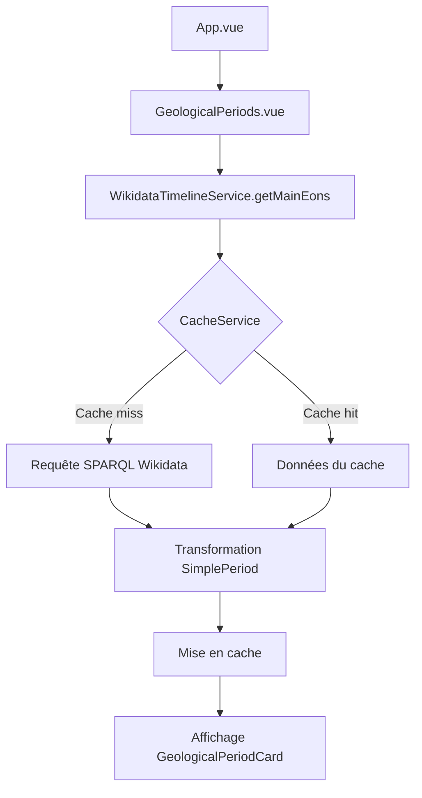
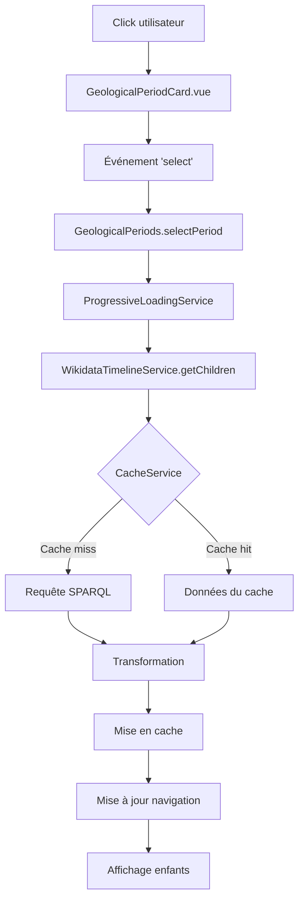
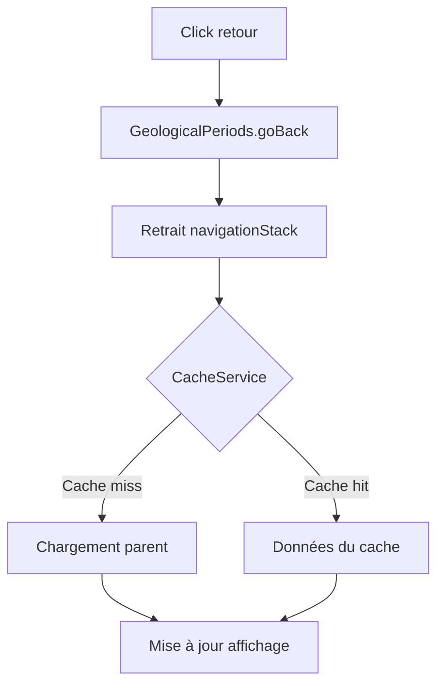
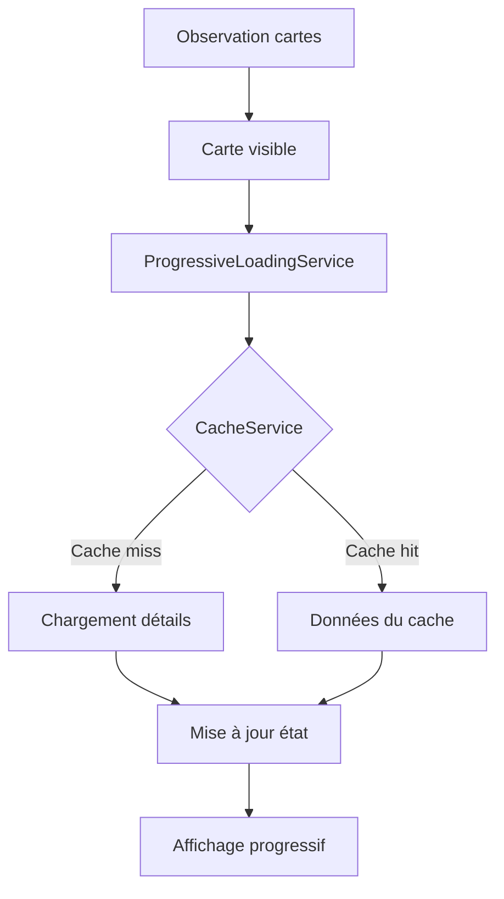
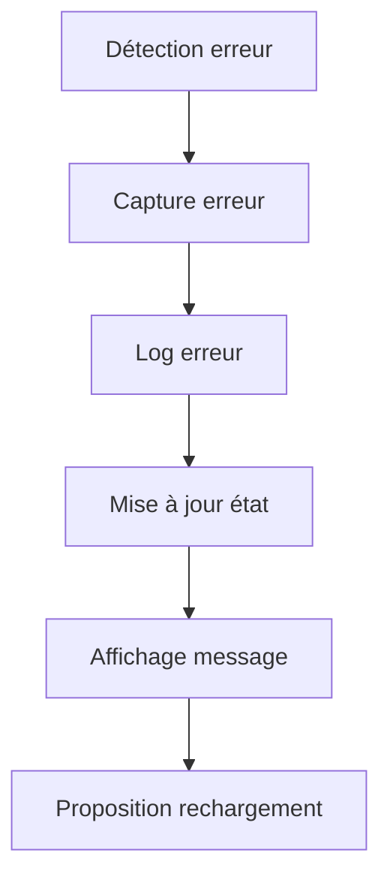
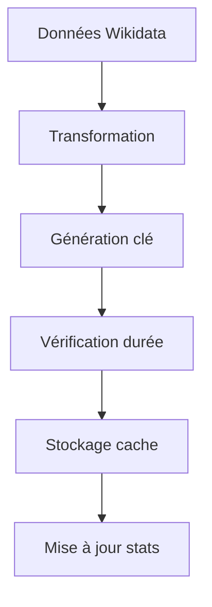
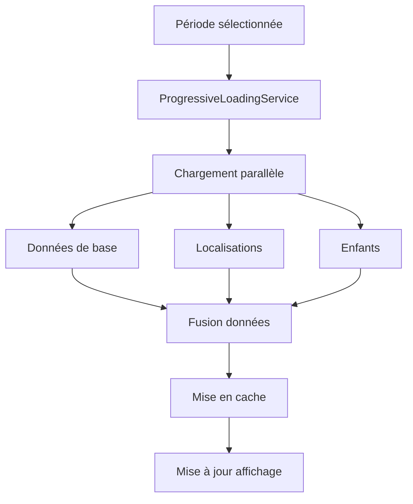
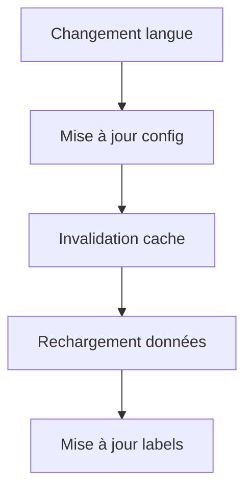

# Documentation des Flux de Données

## Table des matières
1. [Flux de démarrage](#flux-de-démarrage)
2. [Flux de navigation](#flux-de-navigation)
3. [Flux de chargement progressif](#flux-de-chargement-progressif)
4. [Flux de gestion des erreurs](#flux-de-gestion-des-erreurs)
5. [Flux de mise en cache](#flux-de-mise-en-cache)
6. [Flux de chargement des détails](#flux-de-chargement-des-détails)
7. [Flux de gestion de la langue](#flux-de-gestion-de-la-langue)
8. [Optimisations](#optimisations)

## Flux de démarrage



1. App.vue se charge
2. GeologicalPeriods.vue est initialisé
3. WikidataTimelineService.getMainEons() est appelé
4. CacheService vérifie si les éons sont en cache
5. Si pas en cache → Requête SPARQL à Wikidata
6. Transformation des données en SimplePeriod[]
7. Mise en cache des résultats
8. Affichage des éons dans GeologicalPeriodCard[]

## Flux de navigation

### Clic sur une période


### Navigation arrière


## Flux de chargement progressif



## Flux de gestion des erreurs



## Flux de mise en cache



## Flux de chargement des détails



## Flux de gestion de la langue



## Optimisations

### Système de Cache
- Durée de validité configurable
- Taille maximale limitée
- Statistiques de performance
- Nettoyage automatique

### Chargement Progressif
- Observation des éléments visibles
- Priorisation des chargements
- Gestion de la file d'attente
- Préchargement intelligent

### Gestion des Erreurs
- Retries automatiques
- Messages d'erreur explicites
- Possibilité de rechargement
- Logs détaillés

### Performance
- Requêtes parallèles
- Mise en cache optimisée
- Chargement à la demande
- Gestion de la mémoire

## Notes techniques

### Types de données principaux
```typescript
interface SimplePeriod {
  id: string;
  label: string;
  startDate?: string;
  endDate?: string;
  locations: string[];
  hasChildren: boolean;
}

interface Period extends SimplePeriod {
  children: Period[];
  temporalLocations: TemporalLocation[];
  loading: boolean;
  childrenPreloaded: boolean;
}
```

### Services clés
- WikidataTimelineService : Gestion des données
- CacheService : Optimisation des performances
- ProgressiveLoadingService : Chargement intelligent

### Points d'attention
- Gestion de la mémoire
- Performance des requêtes
- Expérience utilisateur
- Gestion des erreurs 