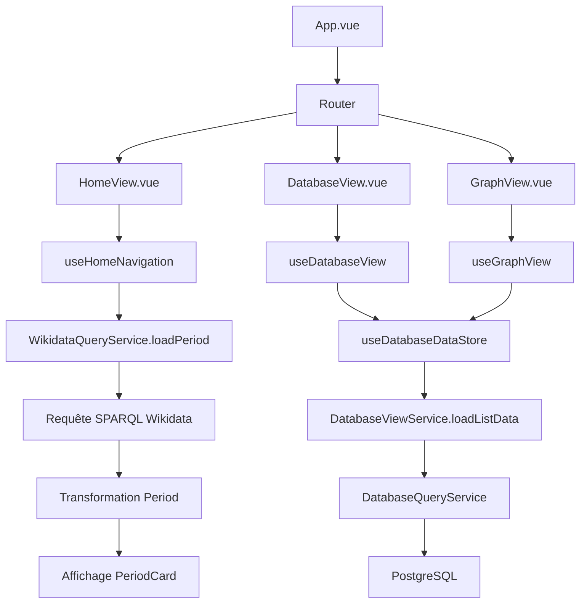
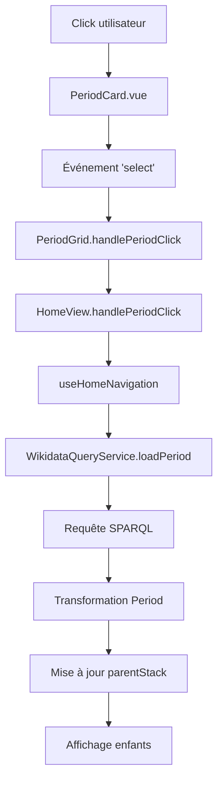
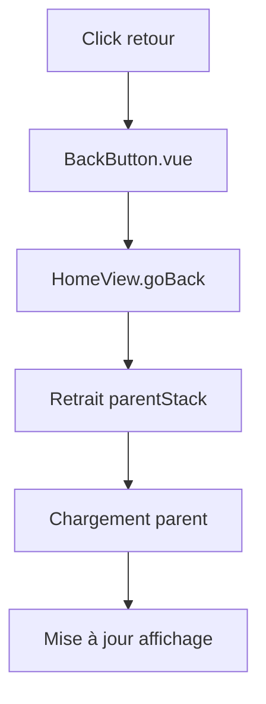
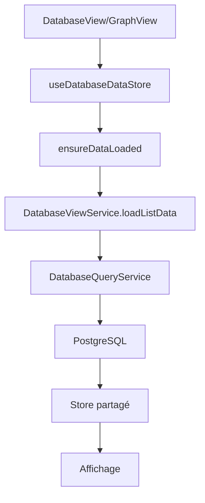
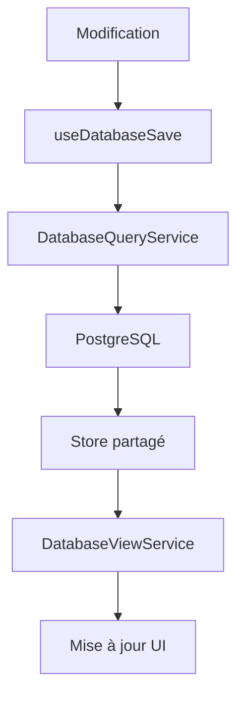
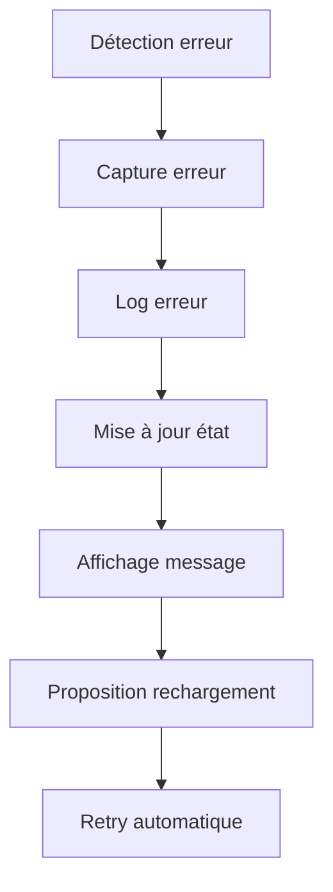
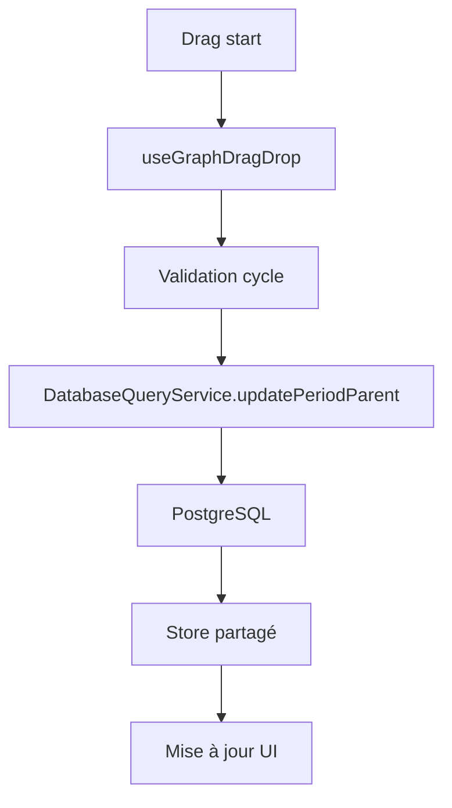
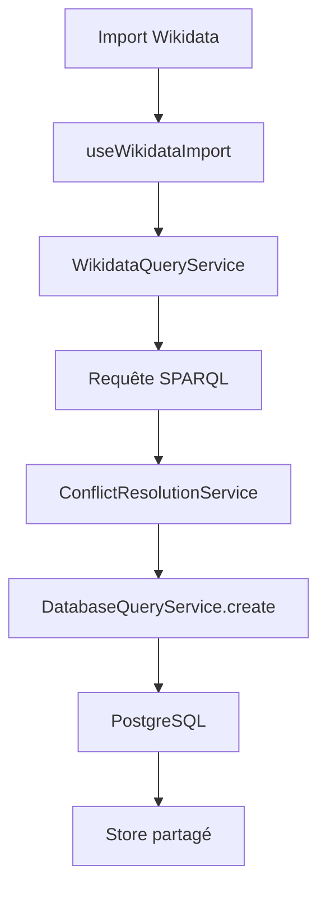
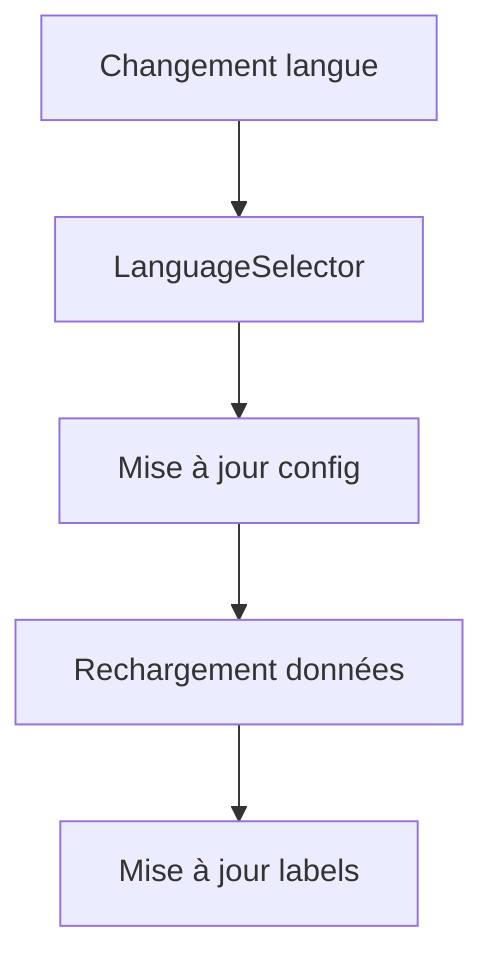

# Documentation des Flux de Données

## Architecture Actuelle

### Vue d'ensemble
L'application utilise une architecture modulaire basée sur des composables Vue 3 avec un store partagé pour mutualiser le chargement des données entre les vues.

### Store Partagé
```typescript
// useDatabaseDataStore.ts
const periods = ref<ListPeriod[]>([]);
const events = ref<ListEvent[]>([]);
const stories = ref<ListStory[]>([]);
const loading = ref(false);
const error = ref<string | null>(null);
```

## Flux de Démarrage



1. **App.vue** se charge avec le router
2. **HomeView** : Navigation hiérarchique dans les périodes géologiques
3. **DatabaseView** : Gestion des données avec store partagé
4. **GraphView** : Visualisation hiérarchique avec drag & drop

## Flux de Navigation (HomeView)

### Clic sur une période


### Navigation arrière


## Flux de Données (DatabaseView/GraphView)

### Chargement initial


### Mise à jour des données


## Flux de Gestion des Erreurs



## Flux de Drag & Drop (GraphView)



## Flux d'Import Wikidata



## Flux de Gestion de la Langue



## Optimisations

### Store Partagé
- **Mutualisation** : DatabaseView et GraphView partagent les mêmes données
- **Chargement unique** : Une seule requête pour les deux vues
- **Mise à jour dynamique** : Rafraîchissement automatique après modifications

### Chargement Progressif
- **Store partagé** : Évite les requêtes multiples
- **Chargement lazy** : Données à la demande
- **Mise à jour ciblée** : Seules les données modifiées sont rafraîchies

### Gestion des Erreurs
- **Retries automatiques** : Maximum 3 tentatives
- **Messages d'erreur explicites** : Feedback utilisateur clair
- **Possibilité de rechargement** : Bouton retry
- **Logs détaillés** : Traçabilité complète

### Performance
- **Requêtes parallèles** : Chargement simultané des données
- **Chargement à la demande** : Données chargées quand nécessaire
- **Gestion de la mémoire** : Optimisation des références
- **Timeout** : 30 secondes avec retry

## Types de Données Principaux

### Types Base de Données
```typescript
interface ListPeriod {
  id: string;
  label: MultilingualText;
  startDate: string;
  endDate: string;
  categories: Category[];
}

interface ListEvent {
  id: string;
  label: MultilingualText;
  date: string;
  categories: Category[];
}

interface ListStory {
  id: string;
  title: MultilingualText;
  categories: Category[];
}
```

### Types Wikidata
```typescript
interface Period {
  id: string;
  wikidata_id?: string;
  label: MultilingualText;
  description?: MultilingualText;
  startDate: string;
  endDate: string;
  hasParent: boolean;
  children: string[];
  temporalLocation: string;
  categories: Category[];
}

interface TemporalLocation {
  startDate?: string;
  endDate?: string;
  location: string;
}
```

## Services Clés

### Accès aux Données
- **`DatabaseQueryService`** : Interface PostgreSQL
- **`WikidataQueryService`** : Requêtes SPARQL Wikidata
- **`WikidataSearchService`** : Recherche Wikidata

### Logique Métier
- **`DatabaseViewService`** : Service spécialisé pour DatabaseView
- **`StoryService`** : Gestion des stories
- **`ConflictResolutionService`** : Résolution des conflits
- **`TimelineScalingService`** : Calculs de positionnement temporel

### Composables
- **`useDatabaseDataStore`** : Store partagé
- **`useDatabaseView`** : Logique DatabaseView
- **`useGraphView`** : Logique GraphView
- **`useHomeNavigation`** : Navigation HomeView
- **`useDatabaseSave`** : Sauvegarde avec retry
- **`useDatabaseDelete`** : Suppression
- **`useGraphDragDrop`** : Drag & drop
- **`useGraphModals`** : Modales GraphView
- **`useEditModal`** : Formulaires d'édition
- **`useWikidataImport`** : Import Wikidata
- **`useParentChildManagement`** : Relations hiérarchiques
- **`useConflictResolution`** : Résolution des conflits

## Points d'Attention

### Performance
- **Store partagé** : Évite les requêtes multiples
- **Chargement lazy** : Données à la demande
- **Mise à jour ciblée** : Rafraîchissement sélectif
- **Filtrage client** : Recherche temps réel

### Gestion de la Mémoire
- **Références partagées** : Évite la duplication
- **Nettoyage automatique** : Gestion des cycles
- **Optimisation des watchers** : Évite les fuites

### Expérience Utilisateur
- **Chargement optimisé** : Feedback visuel
- **Gestion des erreurs** : Messages clairs
- **Support multilingue** : Français et anglais
- **Interface responsive** : Design adaptatif

### Sécurité
- **Validation des données** : Côté client et serveur
- **Sanitisation** : Nettoyage des entrées
- **Gestion des erreurs** : Try/catch robuste
- **Logs structurés** : Traçabilité complète 