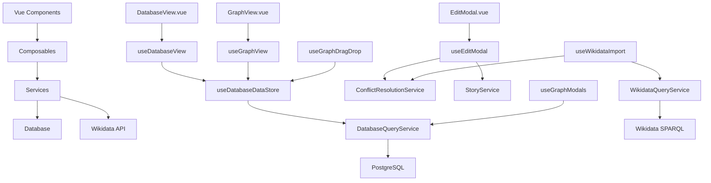

# Documentation Technique

## Architecture générale

### Vue 3 + TypeScript + Composition API

L'application utilise Vue 3 avec la Composition API pour une meilleure organisation du code et une réutilisabilité accrue.

### Structure des données

#### Store partagé `useDatabaseDataStore`
```typescript
// Store centralisé pour mutualiser le chargement des données
const useDatabaseDataStore = () => {
  const periods = ref<Period[]>([])
  const events = ref<Event[]>([])
  const stories = ref<Story[]>([])
  const isLoading = ref(false)
  const error = ref<string | null>(null)
  
  const loadData = async () => {
    // Chargement unique partagé entre DatabaseView et GraphView
  }
  
  return { periods, events, stories, isLoading, error, loadData }
}
```

## Composables Vue 3

### Gestion des données
- **`useDatabaseDataStore`** : Store partagé pour mutualiser le chargement des données entre DatabaseView et GraphView
- **`useDatabaseView`** : Logique de la vue DatabaseView avec filtrage des périodes racines
- **`useGraphView`** : Logique de la vue GraphView avec gestion des colonnes dynamiques
- **`useDatabaseSave`** : Sauvegarde des données avec retry automatique

### Gestion des interactions
- **`useGraphDragDrop`** : Gestion du drag & drop avec mise à jour du store partagé
- **`useGraphModals`** : Gestion des modales GraphView avec chargement direct depuis l'API
- **`useEditModal`** : Gestion des formulaires d'édition centralisée
- **`useHomeNavigation`** : Navigation hiérarchique dans HomeView

### Import et gestion des conflits
- **`useWikidataImport`** : Import des données depuis Wikidata
- **`useParentChildManagement`** : Gestion des relations hiérarchiques
- **`useConflictResolution`** : Résolution des conflits lors de l'import

## Services

### Accès aux données
- **`DatabaseQueryService`** : Interface avec PostgreSQL
- **`WikidataQueryService`** : Requêtes SPARQL vers Wikidata
- **`WikidataSearchService`** : Recherche dans Wikidata

### Logique métier
- **`StoryService`** : Gestion des stories
- **`ConflictResolutionService`** : Résolution des conflits
- **`TimelineScalingService`** : Calculs de positionnement temporel

## Diagramme des dépendances



## Optimisations récentes

### Mutualisation du chargement
- **Store partagé** : `useDatabaseDataStore` évite les requêtes multiples
- **Chargement unique** : DatabaseView et GraphView partagent les mêmes données
- **Mise à jour dynamique** : Le store se met à jour automatiquement après modifications

### Corrections GraphView
- **Modales d'édition** : Chargement direct depuis l'API pour les périodes dynamiques
- **Sous-périodes** : Affichage correct des enfants avec transformation des types
- **Drag & Drop** : Mise à jour du store après déplacement

### Filtrage des périodes
- **DatabaseView** : Affichage des périodes racines uniquement (comme GraphView)
- **Cohérence** : Même logique de filtrage entre les vues
- **Performance** : Réduction du nombre d'éléments affichés

## Types TypeScript

### Types principaux
```typescript
interface Period {
  id: string
  name: string
  startDate: string
  endDate: string
  parentId?: string
  children?: Period[]
}

interface Event {
  id: string
  name: string
  date: string
  storyId: string // Type corrigé : string au lieu de number
}

interface Story {
  id: string
  name: string
  description?: string
}
```

### Corrections de types
- **`storyId`** : Changé de `number` à `string` pour éviter les erreurs de conversion
- **IDs** : Tous les IDs sont maintenant en `string` pour la cohérence
- **Relations** : Types corrects pour les relations parent/enfant

## Validation

### Validation centralisée
```typescript
// validators/editFormValidators.ts
export const validatePeriod = (period: Partial<Period>): ValidationResult => {
  // Validation des dates (non stricte)
  // Validation des champs requis
}
```

### Gestion des erreurs
- **Messages d'erreur** : Affichage utilisateur des erreurs de validation
- **Retry automatique** : Tentatives de sauvegarde en cas d'échec
- **Notifications** : Feedback utilisateur via composant Toast

## Performance

### Optimisations appliquées
- **Store partagé** : Évite les requêtes multiples
- **Chargement lazy** : Données chargées à la demande
- **Mise à jour ciblée** : Seules les données modifiées sont rafraîchies
- **Filtrage côté client** : Recherche en temps réel sans requêtes serveur

### Métriques
- **Temps de chargement** : Réduit grâce au store partagé
- **Mémoire** : Optimisée avec la suppression des services non utilisés
- **Réactivité** : Interface plus fluide avec les mises à jour dynamiques

## Sécurité

### Validation des données
- **Côté client** : Validation TypeScript et validators
- **Côté serveur** : Validation des entrées API
- **Sanitisation** : Nettoyage des données utilisateur

### Gestion des erreurs
- **Try/catch** : Gestion robuste des erreurs
- **Fallbacks** : Valeurs par défaut en cas d'échec
- **Logging** : Traçabilité des erreurs

## Tests

### Tests unitaires
- **Composables** : Tests des logiques métier
- **Services** : Tests des interactions avec les APIs
- **Validators** : Tests de validation des données

### Tests d'intégration
- **Flux complet** : Tests des parcours utilisateur
- **APIs** : Tests des endpoints
- **Base de données** : Tests des requêtes

## Déploiement

### Configuration
- **Docker** : Containerisation avec docker-compose
- **Environnements** : Dev, staging, production
- **Variables d'environnement** : Configuration externalisée

### Monitoring
- **Logs** : Centralisation des logs
- **Métriques** : Monitoring des performances
- **Alertes** : Notifications en cas de problème