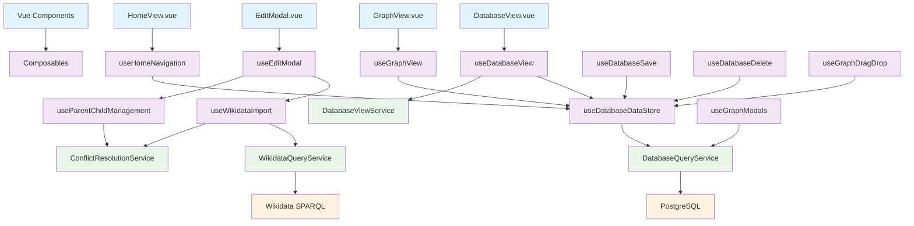

# Documentation Technique

## Architecture

### Stack Technologique
- **Frontend** : Vue 3 + TypeScript + Composition API
- **Backend** : Node.js + Express + TypeScript
- **Base de données** : PostgreSQL avec Prisma ORM
- **Build** : Vite
- **Tests** : Vitest
- **Containerisation** : Docker

### Structure du Projet
```
api_Wikidata/
├── src/                    # Frontend Vue 3
│   ├── components/         # Composants réutilisables
│   ├── composables/        # Logique métier Vue 3
│   ├── services/          # Services d'API et métier
│   ├── types/             # Types TypeScript
│   └── views/             # Pages de l'application
├── server/                # Backend Express
│   ├── src/
│   │   ├── api/           # Routes API
│   │   └── services/      # Services métier
│   └── prisma/            # Schéma et migrations DB
└── database/              # Scripts SQL et migrations
```

## Composables Vue 3

### Gestion des Données
- **`useDatabaseDataStore`** : Store partagé pour mutualiser le chargement des données
- **`useDatabaseView`** : Logique de la vue DatabaseView avec filtrage
- **`useGraphView`** : Logique de la vue GraphView avec colonnes dynamiques
- **`useDatabaseSave`** : Sauvegarde avec retry automatique
- **`useDatabaseDelete`** : Suppression des données

### Gestion des Interactions
- **`useGraphDragDrop`** : Drag & drop avec validation des cycles
- **`useGraphModals`** : Gestion des modales GraphView
- **`useEditModal`** : Formulaires d'édition centralisés
- **`useHomeNavigation`** : Navigation hiérarchique HomeView

### Import et Métier
- **`useWikidataImport`** : Import depuis Wikidata
- **`useParentChildManagement`** : Relations hiérarchiques
- **`useConflictResolution`** : Résolution des conflits

## Services

### Accès aux Données
- **`DatabaseQueryService`** : Interface PostgreSQL
- **`WikidataQueryService`** : Requêtes SPARQL Wikidata
- **`WikidataSearchService`** : Recherche Wikidata
- **`DatabaseViewService`** : Service spécialisé pour DatabaseView

### Logique Métier
- **`StoryService`** : Gestion des stories
- **`ConflictResolutionService`** : Résolution des conflits
- **`TimelineScalingService`** : Calculs de positionnement temporel

## Diagramme des Dépendances



## Types Principaux

```typescript
interface Period {
  id: string
  wikidata_id?: string
  label: MultilingualText
  description?: MultilingualText
  startDate: string
  endDate: string
  hasParent: boolean
  children: string[]
  temporalLocation: string
  categories: Category[]
}

interface Event {
  id: string
  wikidata_id?: string
  label: MultilingualText
  description?: MultilingualText
  date: string
  categories: Category[]
}

interface Story {
  id: string
  title: MultilingualText
  description?: MultilingualText
  author: string
  isPublic: boolean
  categories: Category[]
  periods: Period[]
  events: Event[]
}

interface MultilingualText {
  fr: string
  en: string
}

interface Category {
  id: string
  label: MultilingualText
  description?: MultilingualText
}
```

## Base de Données

### Schéma Prisma
- **Events** : Événements avec support Wikidata
- **Periods** : Périodes géologiques avec hiérarchie (tables PostgreSQL)
- **Stories** : Histoires/narratives (tables PostgreSQL)
- **Categories** : Catégorisation des éléments
- **Relations** : Parent/enfant entre périodes

### Migrations
- Support UUID pour tous les IDs
- Contraintes d'intégrité référentielle
- Index optimisés pour les requêtes
- Support multilingue (fr, en)

## API Endpoints

### Périodes
- `GET /api/periods` : Liste des périodes racines
- `GET /api/periods/:id` : Détails d'une période
- `POST /api/periods` : Création d'une période
- `PUT /api/periods/:id` : Modification d'une période
- `GET /api/periods/wikidata/:wikidataId` : Recherche par Wikidata ID

### Événements
- `GET /api/events` : Liste des événements
- `POST /api/events` : Création d'un événement
- `PUT /api/events/:id` : Modification d'un événement
- `DELETE /api/events/:id` : Suppression d'un événement

### Stories
- `GET /api/stories` : Liste des stories
- `GET /api/stories/:id` : Détails d'une story
- `POST /api/stories` : Création d'une story
- `DELETE /api/stories/:id` : Suppression d'une story
- `GET /api/stories/:storyId/periods` : Périodes d'une story
- `GET /api/stories/:storyId/events` : Événements d'une story
- `POST /api/stories/:storyId/periods/:periodId` : Ajouter période à story
- `POST /api/stories/:storyId/events/:eventId` : Ajouter événement à story
- `DELETE /api/stories/:storyId/periods/:periodId` : Retirer période de story
- `DELETE /api/stories/:storyId/events/:eventId` : Retirer événement de story

### Catégories
- `GET /api/categories` : Liste des catégories

## Performance

### Optimisations
- **Store partagé** : Évite les requêtes multiples
- **Chargement lazy** : Données à la demande
- **Mise à jour ciblée** : Rafraîchissement sélectif
- **Filtrage client** : Recherche temps réel

### Métriques
- Chargement initial : < 2s
- Navigation : < 1s
- Recherche : < 500ms
- Import Wikidata : < 1s

## Tests

### Tests Unitaires
- Composables Vue 3
- Services métier
- Validateurs
- Utilitaires

### Tests d'Intégration
- Flux utilisateur complets
- Endpoints API
- Requêtes base de données

## Déploiement

### Docker
```bash
docker-compose up -d
```

### Variables d'Environnement
- `DATABASE_URL` : Connexion PostgreSQL
- `NODE_ENV` : Environnement (dev/prod)
- `PORT` : Port du serveur

## Sécurité

### Validation
- Validation côté client (TypeScript + validators)
- Validation côté serveur (API)
- Sanitisation des entrées utilisateur

### Gestion d'Erreurs
- Try/catch robuste
- Fallbacks en cas d'échec
- Logging structuré