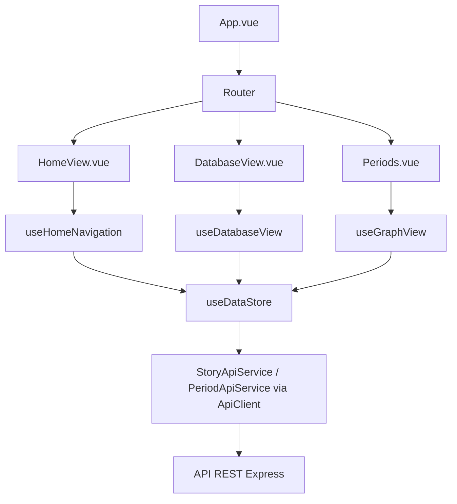
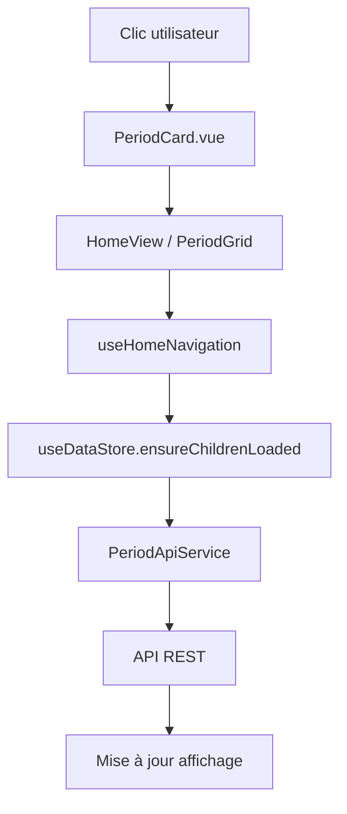
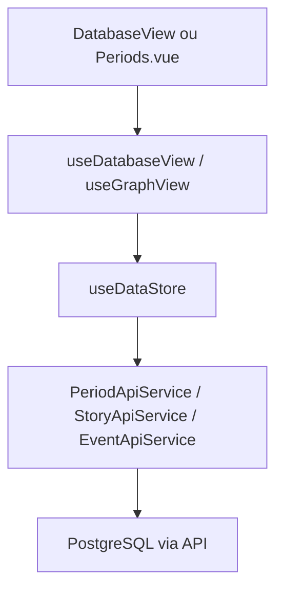
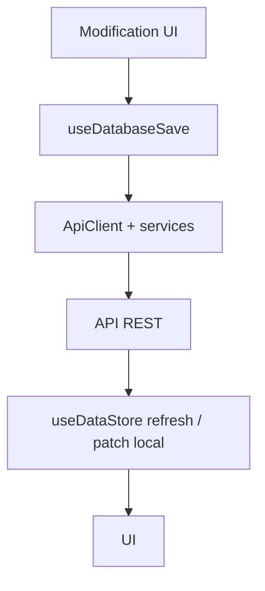
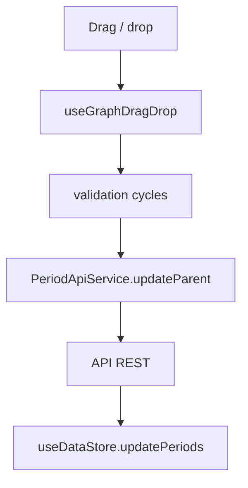
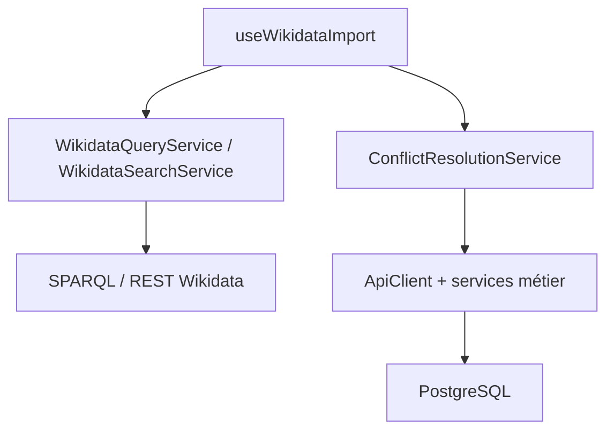

# Documentation des flux de données

*Aligné sur le code (Pinia + `ApiClient` + services). Mis à jour : 2026-04-11.*

## Architecture actuelle

### Vue d’ensemble
L’application s’appuie sur des **composables Vue 3**, un **store Pinia** (`useDataStore`) et des **services HTTP** (`PeriodApiService`, `EventApiService`, `StoryApiService`, `SearchApiService`, etc.) exposés depuis `src/services/index.ts`.

### Store Pinia
Le store central est **`src/stores/useDataStore.ts`** : périodes, événements, stories, drapeaux de chargement, méthodes du type `ensureRootsLoaded`, `ensureStoryPeriodsLoaded`, `ensureChildrenLoaded`, etc. Les vues (`DatabaseView`, `Periods.vue`, `HomeView.vue`) et composables (`useDatabaseView`, `useGraphView`, `useHomeNavigation`, …) lisent et mettent à jour ce store plutôt qu’un ancien composable « data store » supprimé.

## Flux de démarrage



1. **`App.vue`** monte le routeur et le shell (header, bascule de vues).
2. **`HomeView`** : `useHomeNavigation` charge la story d’entrée (`ENTRY_STORY_ID`), les périodes associées via le store, avec repli sur les **racines** API si besoin.
3. **`DatabaseView`** / **`Periods.vue`** : composables branchés sur **`useDataStore`** + appels API selon l’écran.

## Flux de navigation (HomeView)

### Clic sur une période


Wikidata (**`WikidataQueryService`**) intervient notamment pour le **finder** / vues graphe (enfants virtuels, requêtes SPARQL), pas comme unique source du chargement initial de la timeline home.

### Navigation arrière
Le bouton retour dépile la pile de parents gérée dans **`useHomeNavigation`** et recharge l’affichage depuis le store / API selon le niveau.

## Flux DatabaseView / vue Periods

### Chargement


### Mise à jour après sauvegarde


## Drag & drop (vue Periods)



## Import Wikidata



## Gestion des erreurs (schéma)
Les erreurs remontent en **`ref`/toasts** selon les composables ; le serveur journalise surtout via **`console.error`** — pas de couche de logging structurée unique documentée ici.

## Types principaux (`src/types/database.ts`)

Les listes utilisées par l’UI incluent notamment :

```typescript
interface ListPeriod {
  id: string;
  label: MultilingualText;
  startDate: string;
  endDate: string;
  categories: Category[];
  parentId?: string | null;
  hasParent?: boolean;
  hasChildren?: boolean;
  wikidata_id?: string;
  startYearsBP?: number;
  endYearsBP?: number;
  description?: MultilingualText;
  children?: string[];
  temporalLocation?: string;
  createdAt?: Date;
  updatedAt?: Date;
}

interface ListEvent {
  id: string;
  label: MultilingualText;
  date: string;
  categories: Category[];
  dateYearsBP?: number;
  createdAt?: Date;
  updatedAt?: Date;
}

interface ListStory {
  id: string;
  title: MultilingualText;
  categories: Category[];
  startDate?: string;
  endDate?: string;
}
```

Pour les entités complètes (`Period`, `Event`, `Story`), voir le même fichier source.

## Services et composables (références)

- **Services** : `src/services/index.ts` et fichiers `*ApiService.ts`, `ApiClient.ts`, `WikidataQueryService.ts`, …
- **Composables** : `src/composables/` (`useDatabaseView`, `useGraphView`, `useDatabaseSave`, `useGraphDragDrop`, `useWikidataImport`, `useParentChildManagement`, …). **Il n’existe pas** de `useConflictResolution` : la logique de conflits passe par **`ConflictResolutionService`**.

## Optimisations (rappel)

- **Pinia** : une seule copie des listes partagées entre vues qui s’y abonnent.
- **Chargement lazy** : enfants de périodes, agrégations stories, etc., à la demande.
- **Retries** : notamment côté Wikidata / appels sensibles (voir implémentations dans les services et `retryAsyncOperation`).

Liste complète des routes : **`server/src/api/routes.ts`**.
