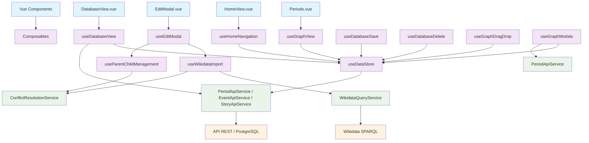

# Documentation Technique

## Architecture

### Stack Technologique
- **Frontend** : Vue 3 + TypeScript + Composition API
- **Backend** : Node.js + Express + TypeScript
- **Base de données** : PostgreSQL (schémas SQL versionnés) ; Prisma présent mais le `schema.prisma` du dépôt est **partiel** — voir section *Base de Données*.
- **Build** : Vite
- **Tests** : Vitest
- **Containerisation** : Docker

### Structure du Projet
```
web-chronologie-univers-2/
├── src/
│   ├── App.vue                  # Shell : Header, bascule de vues ; timeline = HomeView en v-show (état conservé) ; DatabaseView en v-if (démontée hors onglet Stories)
│   ├── main.ts
│   ├── router/
│   ├── components/              # Composants réutilisables
│   │   └── base/                # Button, Input, Select + SelectShell, SearchInput, Switch, ConfirmModal, ModalShell, Tabs, … (+ CSS partagés select-field-shared, select-period-toolbar)
│   ├── composables/             # Composition API (glue vues ↔ services / UI)
│   ├── lib/                     # Fonctions pures et helpers sans état Vue
│   ├── services/                # Clients HTTP, DateService, Wikidata, …
│   ├── stores/                  # Pinia (données globales côté client)
│   ├── styles/                  # variables, base, finder-column-layout, …
│   ├── types/
│   ├── utils/                   # ex. uuid, generateDomUid (ids DOM courts)
│   ├── validators/              # minimal — ex. `editFormValidators.ts`
│   └── views/                   # `HomeView.vue` à la racine ; `HomeView/` (PeriodCard, PeriodGrid) ; DatabaseView, EventsView, GraphView/Periods, …
├── server/                      # Backend Express + Prisma
│   ├── src/
│   │   ├── api/
│   │   └── …
│   └── prisma/
├── database/
├── Documentation/               # Docs projet (ce fichier, statut, flux, …)
└── audits/                    # Audits (composables, CSS, imports, doublons, …)
```

### Composants de Base

#### Button (`components/base/Button.vue`)
- Variante **primary** : fond `var(--color-primary-button)` / survol `var(--color-primary-button-hover)` (bleu plus soutenu que `--color-primary` pour un bon contraste avec le texte blanc). Définis dans `styles/variables.css` (clair et sombre).
- Variantes : `primary`, `secondary`, `tertiary`, `danger`.
- Taille : `size="sm"` pour les barres d’outils (hauteur ~36px) ; `md` par défaut.
- Icône : prop `icon` (classe CSS sur `<i>`) ou slot nommé `#icon` (ex. composant Lucide) ; combinable avec `icon-only` pour un bouton carré.

#### Input (`components/base/Input.vue`)
- Prop optionnelle `compact` : champ plus bas, adapté aux filtres en ligne.

#### Finder (colonnes type navigateur)
- Ligne d’item : **`src/views/GraphView/FinderItem.vue`** (libellé multilingue, sous-titre dates, état sélectionné, chevron, DnD, bouton Edit / Add selon le contexte).
- Mise en page colonnes : **`src/styles/finder-column-layout.css`** (classes `finder-columns`, `finder-column`, `finder-column-header`, `finder-column-content`, `finder-empty-column`, `finder-columns--demo`, `finder-column--fill` pour une colonne sans largeur fixe 300px) ; importé depuis **`src/style.css`** (lui-même importé par **`src/main.ts`**). **Autres CSS** : certaines feuilles des composants base sont chargées au niveau des SFC (`<style src="…">`), par ex. **`select-period-toolbar.css`** dans **`Select.vue`** et **`select-field-shared.css`** dans **`SelectShell.vue`**, en complément du chaînage global. Utilisé notamment par **`Periods.vue`** et la colonne stories de **`DatabaseView.vue`**. Prévisualisation : vue **Design system** → onglet **Finder**.
- **`Tabs.vue`** : horizontal ou `vertical` (style colonne Finder : fond surface, séparateurs, actif = primaire + texte blanc). Chaque entrée **`Tab`** peut avoir un **`sublabel`** optionnel (texte complémentaire sous le label, taille **`--font-size-sm`**). Vue **Stories** : onglets verticaux avec **`sublabel`** = plage temporelle (`DateService`, même logique que sous-titre **Finder**).
- **Design system** (`/design-system`) : menu **Tokens** découpé en trois entrées (**Couleurs**, **Typographie**, **Espacements & effets**) — une page par famille. Les échelles **`--font-size-*`**, **`--line-height-*`**, **`--base-line-height`** et **`--spacing-*`** sont en **pixels entiers** dans **`src/styles/variables.css`** (repères **`--base-font-size`** 13px, **`--base-spacing`** 8px).

#### Select — mode `period` (`components/base/Select.vue` + `SelectShell.vue`)
- **`Select.vue`** s’appuie sur **`SelectShell.vue`** pour le gabarit déclencheur / liste ; styles partagés du champ : **`select-field-shared.css`** (shell), barre d’outils mode période : **`select-period-toolbar.css`** + classe **`.select--period-toolbar`** sur la racine du shell en mode period.
- **`mode="period"`** : même comportement que l’ancien filtre événements (navigation par niveau, libellés avec dates, chevron sous-périodes, « Toutes les périodes », retour niveau parent). Utilisé dans **`EventsView`** à la place de l’ancien `EventsPeriodFilter`.

#### Select Component
Composant de sélection avec autocomplétion qui suit le design system de l'application.

**Fonctionnalités :**
- ✅ Sélection simple et multiple
- ✅ Autocomplétion avec recherche
- ✅ Navigation au clavier (flèches, Entrée, Échap)
- ✅ Support des états d'erreur et d'aide
- ✅ Accessibilité (ARIA)
- ✅ Design responsive
- ✅ Thème sombre/clair
- ✅ Transitions fluides

**Utilisation :**
```vue
<script setup>
import BaseSelect from '@/components/base/Select.vue';

const selectedValue = ref(null);
const options = [
  { value: 'fr', label: 'France' },
  { value: 'us', label: 'États-Unis' }
];
</script>

<template>
  <!-- Sélection simple -->
  <BaseSelect
    v-model="selectedValue"
    :options="options"
    label="Choisir un pays"
    placeholder="Sélectionner un pays"
  />
  
  <!-- Sélection multiple -->
  <BaseSelect
    v-model="multipleValues"
    :options="options"
    :multiple="true"
    label="Choisir plusieurs pays"
  />
</template>
```

**Props principales :**
- `modelValue` : Valeur(s) sélectionnée(s)
- `options` : Liste des options (interface `SelectOption`)
- `multiple` : Mode sélection multiple (défaut: `false`)
- `searchable` : Activer la recherche (défaut: `true`)
- `label`, `placeholder`, `error`, `hint` : Interface utilisateur
- `required`, `disabled` : États du champ
- `compact` : déclencheur et liste plus compacts (filtres, barres d’outils)

**Interface SelectOption :**
```typescript
interface SelectOption {
  value: string | number;
  label: string;
  disabled?: boolean;
}
```

**Navigation au clavier :**
- **Flèche bas** : Ouvrir le dropdown / Naviguer vers le bas
- **Flèche haut** : Naviguer vers le haut
- **Entrée/Espace** : Sélectionner l'option surlignée
- **Échap** : Fermer le dropdown
- **Tab** : Fermer le dropdown et passer au champ suivant

## Composables Vue 3

Les modules suivants vivent dans **`src/composables/`** (état / effets Vue, branchement sur **`useDataStore`** ou les services). Le **store Pinia** est documenté plus bas (`src/stores/`).

### Données & vues principales
- **`useDatabaseView`** : état et actions de la vue Database (liste stories, panneau détail, modales liées).
- **`useDatabaseSave`** : flux de sauvegarde création / édition (formulaires, API).
- **`useDatabaseDelete`** : suppressions côté API avec retour d’erreur géré pour l’UI.
- **`useGraphView`** : logique de **`Periods.vue`** (colonnes, chargement enfants) ; en secours Wikidata si besoin ; export **`mapWikidataGeologicalChildToListPeriod`** pour lignes virtuelles (`id` préfixé `wikidata:`).
- **`useHomeNavigation`** : navigation hiérarchique de la timeline (**`HomeView.vue`** + **`PeriodGrid`**).

### Interactions graphiques & modales
- **`useGraphDragDrop`** : drag & drop du finder avec garde-fous (cycles, cibles).
- **`useGraphModals`** : ouverture / données des modales liées à **`Periods.vue`**.
- **`useEditModal`** : état des modales d’édition / création (type d’entité, payload).
- **`useModalState`** : helpers d’état pour modales simples (pattern réutilisable).
- **`useLoadingState`** : indicateurs de chargement partagés là où le composable est branché.

### Présentation & thème
- **`useToast`** : file / affichage des toasts (souvent via `window.toast` exposé dans **`App.vue`**).
- **`useDocumentTheme`** : thème clair / sombre au niveau document (`<html>` / classes CSS).

### Import, dates & échelle
- **`useWikidataImport`** : flux d’import Wikidata (progression, erreurs, rattachement au formulaire).
- **`useParentChildManagement`** : relations parent / enfant (périodes) pour l’édition.
- **`useTimelineScaling`** : échelle temporelle et positionnement (s’appuie sur **`TimelineScalingService`**).
- **`useDateConversion`** : accès UI à **`DateConversionService`** (conversion / affichage paramétrables).

## Utilitaires `src/lib/`

Fonctions **pures** ou presque (pas de `ref` / cycle de vie Vue). Liste alignée sur le dépôt :

- **`buildNewEntityCoreFields.ts`** : champs communs `id` / `wikidata_id` / `label` / `description` pour création événement ou période.
- **`collectionUtils.ts`** : petits helpers sur collections / listes.
- **`finderItemDateLabels.ts`** : libellés de dates pour les lignes Finder.
- **`formatPeriodTreeItemDates.ts`** : chaîne d’intervalle pour une période « story » dans l’arbre.
- **`formatTemporalBoundLabel.ts`** : bornes temporelles affichées (dont recherche, liste stories, libellé événement panneau).
- **`graphFinderHelpers.ts`** : calculs / clés pour le finder graphe.
- **`listEventTableHelpers.ts`** : tri / clés pour le tableau événements.
- **`modalOverlayDismiss.ts`** : logique réutilisable de fermeture modale (clic overlay, etc., si utilisé).
- **`periodAncestorChain.ts`** : reconstruction de chaîne d’ancêtres pour pickers période.
- **`periodCardClickIntent.ts`** : distinction clic / intention sur carte période (home).
- **`periodTreeLabelKey.ts`** : `labelKey` et comparateur **`compareStoryPeriodsByLabel`** pour l’arbre périodes story.
- **`retryAsyncOperation.ts`** : tentatives avec délai (ex. requêtes Wikidata).
- **`searchHitDisplay.ts`** : affichage cohérent d’un résultat de recherche (local / Wikidata).
- **`selectListPeriodHelpers.ts`** : helpers liste / tri pour le select mode liste.
- **`storyPeriodBoundaryYbp.ts`** : bornes temporelles en années avant présent pour filtrage story.
- **`storyTimelineLabels.ts`** : libellés pour **`StoryTimeline`**.
- **`wikidataImportButtonHelpers.ts`** : logique autour du bouton d’import Wikidata.
- **`wikidataImportFormMerge.ts`** : fusion des données importées dans un formulaire.
- **`wikidataSearchResultUi.ts`** : formatage UI des résultats de recherche Wikidata.
- **`timelinePeriodGridHelpers.ts`** : helpers pour la grille périodes / timeline (positionnement, repères).

## Stores Pinia `src/stores/`

- **`useDataStore.ts`** : store central (périodes, événements, stories, chargements lazy, enfants, etc.) — les vues et composables s’y branchent à la place d’un ancien « data store » composable supprimé.

## Services

Modules dans **`src/services/`** ; réexports principaux dans **`index.ts`** (`ApiClient`, `*ApiService`, Wikidata, conversion de dates).

### Accès HTTP / API REST
- **`ApiClient`** : client HTTP partagé (base URL, requêtes).
- **`PeriodApiService`** : périodes (racines, détail, enfants, CRUD via l’API).
- **`EventApiService`** : événements.
- **`StoryApiService`** : stories (liste, détail, liaisons périodes / événements).
- **`SearchApiService`** : recherche globale (`GET /api/search`).

### Wikidata
- **`WikidataQueryService`** : requêtes SPARQL ; `loadPeriodChildrenByWikidataId(Qid)` charge les enfants P361 pour le finder en **une** requête (labels dans le résultat) ; `loadPeriod` enrichit encore les enfants avec des requêtes temporelles **par paquets** pour limiter les 429 Wikidata. **Développement (Vite)** : URL SPARQL par défaut via proxy **`/api/wikidata/sparql`**. **Production** (sans `VITE_WIKIDATA_SPARQL_URL`) : `https://query.wikidata.org/sparql`.
- **`WikidataSearchService`** : recherche d’entités Wikidata.
- **`WikidataStoryService`** : chargement / structuration de contenus story depuis Wikidata.

### Utilitaires & métier
- **`DateService`** : parsing / formatage pour l’UI (Finder, modales, onglets Stories).
- **`CategoryService`** : liste des catégories (ex. formulaires d’édition).
- **`ConflictResolutionService`** : résolution de conflits (import Wikidata).
- **`TimelineScalingService`** : calculs de positionnement temporel.
- **`DateConversionService`** : conversion de dates entre formats temporels.

## Diagramme des Dépendances



## Types Principaux

Extraits alignés sur **`src/types/database.ts`** (certains champs optionnels ou relations omis pour brièveté).

```typescript
interface Period {
  id: string
  wikidata_id?: string
  label: MultilingualText
  description?: MultilingualText
  startDate: string
  endDate: string
  hasParent: boolean
  children: string[]
  temporalLocation: string
  categories: Category[]
  createdAt: Date
  updatedAt: Date
}

interface Event {
  id: string
  wikidata_id?: string
  label: MultilingualText
  description?: MultilingualText
  date: string
  categories: Category[]
  createdAt: Date
  updatedAt: Date
}

interface Story {
  id: string
  title: MultilingualText
  description?: MultilingualText
  author: string
  isPublic: boolean
  categories: Category[]
  periods: Period[]
  events: Event[]
  createdAt: Date
  updatedAt: Date
}

interface MultilingualText {
  fr: string
  en: string
}

interface Category {
  id: string
  label: MultilingualText
  description?: MultilingualText
}
```

Pour les **listes** (`ListPeriod`, `ListEvent`, `ListStory`), les champs réellement renvoyés par l’API (ex. `parentId`, `hasChildren`, `startYearsBP` / `endYearsBP`, `dateYearsBP`, bornes agrégées des stories) sont dans **`src/types/database.ts`** — ne pas se fier à d’anciennes interfaces fictives (`temporalData`, `isMainEon`, etc.).

## Base de Données

### Schéma PostgreSQL et Prisma
- **Source de vérité SQL** : schémas PostgreSQL `periods`, `events`, `stories`, `categories` (tables, index, triggers) décrits dans **`database/supabase-init.sql`** et complétés par les migrations sous **`server/prisma/migrations/`** (ex. colonnes `*_years_bp`).
- **Prisma** : le fichier **`server/prisma/schema.prisma`** du dépôt est **partiel** (il ne modélise pas encore l’ensemble des entités ci-dessous) ; l’API Express s’appuie surtout sur du SQL via **`server/src/api/database.ts`**. Les puces suivantes décrivent le **modèle métier** tel qu’utilisé côté application, pas l’intégralité du fichier Prisma actuel.
- **Events** : Événements avec support Wikidata
- **Periods** : Périodes géologiques avec hiérarchie (tables PostgreSQL)
- **Stories** : Histoires/narratives (tables PostgreSQL)
- **Categories** : Catégorisation des éléments
- **Relations** : Parent/enfant entre périodes

### Tables de Liaison des Catégories
Tables réelles qualifiées par schéma (ex. **`categories.period_categories`**, **`categories.event_categories`**, **`categories.story_categories`**) avec contraintes et index tels que versionnés dans **`database/supabase-init.sql`**. Pour tout script ou migration, se référer à ce fichier plutôt qu’à un extrait SQL simplifié.

### Catégories par Défaut
Le système inclut 18 catégories prédéfinies :
- Cosmologie, Astrophysique, Physique Théorique
- Biologie Évolutive, Paléontologie, Physique des Particules
- Géologie, Chimie, Botanique
- Histoire et Civilisations, Anthropologie et Archéologie
- Technologie et Innovations, Religion et Philosophie
- Art et Culture, Économie, Océanographie
- Microbiologie, Écologie

### Migrations
- Support UUID pour tous les IDs
- Contraintes d'intégrité référentielle
- Index optimisés pour les requêtes
- Support multilingue (fr, en)
- **Tables de liaison catégories** : Relations many-to-many
- **Cascade DELETE** : Suppression automatique des relations

## API Endpoints

La liste ci-dessous n’est pas exhaustive : voir **`server/src/api/routes.ts`** pour l’ensemble des routes.

### Format des Données

#### Catégories
Les catégories sont envoyées au backend sous forme d'objets avec la propriété `id` :
```typescript
// Format correct pour les catégories
categories: [
  { id: "5599cb7b-8a28-42ff-a300-d159b5e22b78" },
  { id: "7a8b9c0d-1e2f-3g4h-5i6j-7k8l9m0n1o2p" }
]

// Le frontend filtre automatiquement les valeurs null/undefined
// et transforme les IDs en objets { id: ... }
```

### Périodes
- `GET /api/periods` : Liste des périodes racines
- `GET /api/periods/:id` : Détails d'une période
- `GET /api/periods/:id/children` : Enfants directs d’une période (finder / graphe)
- `POST /api/periods` : Création d'une période
- `PUT /api/periods/:id` : Modification d'une période
- `GET /api/periods/wikidata/:wikidataId` : Recherche par Wikidata ID

### Événements
- `GET /api/events` : Liste des événements
- `POST /api/events` : Création d'un événement
- `PUT /api/events/:id` : Modification d'un événement
- `DELETE /api/events/:id` : Suppression d'un événement

### Stories
- `GET /api/stories` : Liste des stories avec **`start_date`** / **`end_date`** agrégés (jointure `story_id::text = id::text`). **Début** = min des `start_date` des périodes liées et des `date` des événements ; **fin** = max des `end_date` des périodes et des `date` des événements (ordre texte).
- `GET /api/stories/temporal-bounds` : même agrégation, une ligne par story concernée — le front fusionne dans la liste après chargement (vue Stories) pour fiabiliser l’affichage du menu.
- `GET /api/stories/:id` : Détails d'une story
- `POST /api/stories` : Création d'une story
- `PUT /api/stories/:id` : Modification d'une story
- `DELETE /api/stories/:id` : Suppression d'une story
- `GET /api/stories/:storyId/periods` : Périodes d'une story
- `GET /api/stories/:storyId/events` : Événements d'une story
- `POST /api/stories/:storyId/periods/:periodId` : Ajouter période à story
- `POST /api/stories/:storyId/events/:eventId` : Ajouter événement à story
- `DELETE /api/stories/:storyId/periods/:periodId` : Retirer période de story
- `DELETE /api/stories/:storyId/events/:eventId` : Retirer événement de story

### Catégories
- `GET /api/categories` : Liste des catégories

### Recherche
- `GET /api/search` : recherche globale (paramètres selon implémentation dans `routes.ts`)

## Performance

### Optimisations
- **Store partagé** : Évite les requêtes multiples
- **Chargement lazy** : Données à la demande
- **Mise à jour ciblée** : Rafraîchissement sélectif
- **Filtrage client** : Recherche temps réel

### Métriques
Objectifs produit **non vérifiés** par des tests de performance ou des mesures automatisées dans le dépôt :
- Chargement initial : viser moins de 2 s
- Navigation : viser moins de 1 s
- Recherche : viser moins de 500 ms
- Import Wikidata : viser moins de 1 s

## Tests

### Tests Unitaires
- Composables Vue 3
- Services métier
- Validateurs
- Utilitaires

### Tests d'Intégration
La couverture actuelle est surtout **unitaire** (Vitest : services, utilitaires, quelques tests Vue). Il n’existe pas, à ce stade, une suite d’intégration dédiée couvrant systématiquement des flux utilisateur complets, tous les endpoints API ou les requêtes base de données.

## Déploiement

### Docker
```bash
docker-compose up -d
```

### Variables d'Environnement
- `DATABASE_URL` : Connexion PostgreSQL
- `NODE_ENV` : Environnement (dev/prod)
- `PORT` : Port du serveur

## Sécurité

### Validation
- Validation côté client (TypeScript + validators)
- Validation côté serveur (API)
- Sanitisation des entrées utilisateur

### Gestion d'Erreurs
- Try/catch robuste
- Fallbacks en cas d'échec
- Logs côté serveur principalement via `console` ; pas de pipeline unique de « logging structuré » documenté dans le dépôt

## Service de Conversion de Dates

### Fonctionnalités
Le `DateConversionService` gère la conversion entre différents formats temporels :

- **Format ISO8601** : `-3600000000-01-01T00:00:00Z` (dates très anciennes)
- **Format Moderne** : `18 avril 1923` (dates récentes)
- **Format BCE** : `800 BCE`, `-800` (dates historiques)
- **Format Géologique** : `4 Ma`, `4.5 Ga`, `40 ka` (dates préhistoriques)

### API Principale
```typescript
// Conversion simple
const result = DateConversionService.convertDate('4 Ma');
// Retourne: { iso8601: '-4000000-01-01T00:00:00Z', geological: '4.00 Ma', ... }

// Conversion de plage
const range = DateConversionService.convertDateRange('4 Ma', '2 Ma');
// Retourne: { start: ..., end: ..., duration: { years: 2000000, geological: '2.00 Ma' } }

// Formatage contextuel
const display = DateConversionService.formatForDisplay('4 Ma', 'timeline');
// Retourne: '4.00 Ma'
```

### Composable Vue 3
```typescript
const { convertedDate, convertDate, formatForDisplay } = useDateConversion({
  defaultLocale: 'fr-FR',
  defaultPrecision: 'year'
});
```

### Seuils Géologiques
- **Ga (Giga-années)** : ≥ 1 000 000 000 ans
- **Ma (Méga-années)** : ≥ 1 000 000 ans  
- **ka (kilo-années)** : ≥ 1 000 ans
- **ans** : < 1 000 ans