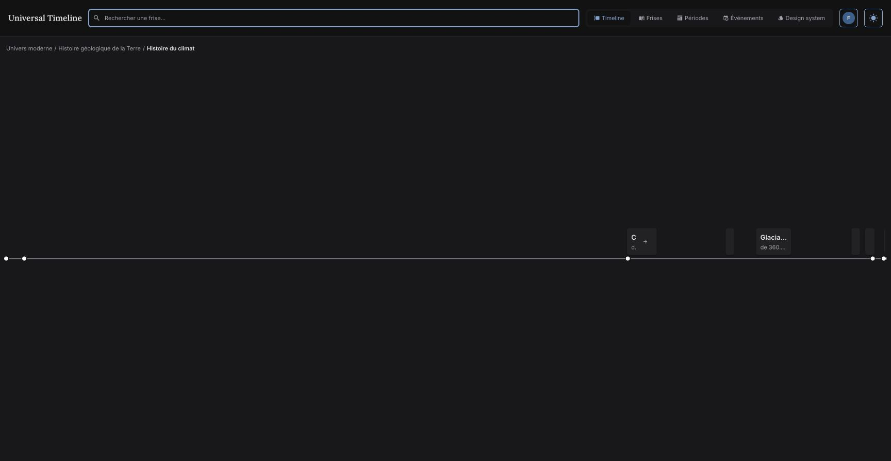

# Navigation timeline : essais et diagnostic

**État ultérieur :** les corrections de navigation autorisées après cet audit sont décrites dans [CORRECTIONS.md](./CORRECTIONS.md). L'échelle des périodes est conservée à la demande explicite de l'utilisateur. Les constats ci-dessous décrivent l'état avant correction ; l’ancien second menu a depuis été supprimé et sa reproduction est conservée comme archive texte.

2 novembre 2026. Essais sur **http://localhost:5173**, dans Chrome, vue bureau de 1728 × 896 pixels, thème sombre, session existante. Version locale en cours de modification ; aucune modification du code applicatif ni des données effectuée pendant cet audit. Seuls les fichiers de ce dossier ont été ajoutés.

## Verdict

La gêne provient d'abord de **comportements de navigation incohérents et de deux bugs observables**, puis de la lisibilité à grande échelle. Le modèle de données sait déjà exprimer un parcours chronologique explicite : le parcours historique fonctionne. Il ne semble pas nécessaire de reconstruire le catalogue ou de créer un arbre universel.

Le lecteur doit aujourd'hui deviner si un clic va sélectionner une période, descendre dans ses subdivisions, ouvrir une autre frise, proposer des choix ou ne rien afficher. Des liens de parenté éditoriale et des associations thématiques sont présentés avec des signes voisins de ceux d'une hiérarchie temporelle. Cette ambiguïté traverse les données, le code et l'interface.

## Parcours réellement testés

| Parcours / action | Résultat constaté |
| --- | --- |
| Univers → Voie Lactée → Système solaire | Descente fonctionnelle, mais URL inchangée à `/timeline`. |
| Clic sur Terre dans Système solaire | Aucun menu visible malgré deux frises enfants ancrées sur Terre. Le badge permet d'accéder aux deux destinations. |
| Badge Terre → Histoire géologique de la Terre → Phanérozoïque → Mésozoïque | Exploration fonctionnelle. URL toujours `/timeline`, y compris après changement de frise. |
| Clic sur Jurassique | Aucun changement visible. Deux frises sont pourtant proposées par le badge. |
| Badge Jurassique → Les cinq grandes extinctions | Ouverture de la frise à Phanérozoïque ; le focus Jurassique n'est pas conservé. |
| Recharger cette page | Retour à Univers, car l'adresse est toujours `/timeline`. |
| Recherche « Moyen » → Moyen Âge | Ouverture de `/timeline?story=15`, période Moyen Âge et voisins Antiquité / Époque moderne. |
| Moyen Âge → Époque moderne → Histoire contemporaine | Fonctionne, y compris entre deux périodes de la même frise. Les URL contiennent `story`, `period`, `context`. |
| Recharger Histoire contemporaine, puis retour navigateur | Période restaurée ; retour à Époque moderne correct. |
| Clic sur Moyen Âge central | Aucun changement visible. |
| Clic sur Moyen Âge tardif | Ouvre directement Renaissance, sans annoncer le changement de frise ; le contexte historique disparaît. |
| Recherche « climat » → Histoire du climat → Quaternaire → Précédent | Vue Quaternaire puis Optimum climatique de l'Éocène, selon le tri des racines de cette sélection thématique. Adresse inchangée à `story=23`. |
| Retour navigateur depuis cette dernière étape | Revient à Renaissance, en sautant les étapes locales Quaternaire / Éocène. |
| Fil d'Ariane Renaissance → Univers moderne | Affiche Univers moderne tout en conservant **`?story=17`**, identifiant de Renaissance. |

## Problèmes par priorité et origine

### 1. P1 — L'adresse et l'historique ne suivent pas tous les déplacements

**Origine : logique applicative / routage.** Les branches utilisant `selectedContext` passent par le routeur, les autres modifient seulement l'état du composable. Une navigation sans contexte peut ainsi changer de période et même de frise sans mettre l'adresse à jour.

Reproduction courte : ouvrir Renaissance (`story=17`), cliquer Univers moderne dans le fil d'Ariane. Le contenu devient Univers moderne, l'adresse reste `story=17`. Preuve textuelle : [url-desynchronisee.txt](./url-desynchronisee.txt).

Impact : un lien copié ne représente pas nécessairement l'écran, un rechargement perd la position, le retour navigateur saute des étapes. Ce problème ne dépend pas d'une refonte du schéma.

Code : `src/composables/useHomeNavigation.ts`, `selectStory` lignes 261–272, `navigateToBreadcrumb` lignes 295–313, déplacement local des périodes lignes 198–203 et navigation adjacente. La route accepte déjà les paramètres nécessaires.

### 2. P1 — Le menu attendu sur Terre est perdu pendant le chargement

**Origine : synchronisation entre composant et composable.** `PeriodGrid.selectPeriod` mémorise le rectangle de la carte, puis émet le clic. `handlePeriodClick` remplace les suggestions par un tableau vide avant leur chargement. Le watcher de `PeriodGrid` efface alors `dropdownRect`. Quand les deux choix arrivent, le menu exige encore ce rectangle et ne s'affiche pas.

Reproduit deux fois dans le navigateur, sans erreur console, puis isolé par un test avec contrôle positif : les mêmes suggestions s'affichent si le rectangle est conservé. Il s'agit d'une panne d'affichage, pas de données absentes.

Le fichier [dropdown-reproduction-historique.txt](./dropdown-reproduction-historique.txt) **vérifie le défaut actuel** ; sa réussite ne signifie pas que le bug est corrigé. Il reste hors de la suite courante et se lance avec la configuration de ce dossier.

### 3. P2 — Une même carte promet plusieurs actions différentes

**Origine : contrat d'interaction.** Jurassique n'a pas d'enfants et son clic cherche seulement les frises enfants ancrées. Son badge emploie un ensemble plus large, comprenant les frises partageant la période. Moyen Âge tardif a une seule destination ancrée : son clic ouvre automatiquement Renaissance. Moyen Âge central n'a aucune destination : son clic ne change rien.

Le résultat d'un clic dépend donc de relations invisibles pour le lecteur. Par ailleurs, la barre de la période courante est un bouton de retour, sans flèche ni libellé de retour visibles.

Recommandation : le clic principal sélectionne toujours la période, y compris une feuille, affiche ses événements et conserve sa position dans l'URL. Une action explicite ouvre ses sous-périodes ; une autre ouvre les frises associées. Éviter l'ouverture automatique d'une frise thématique depuis un clic qui ressemble à une sélection de période.

### 4. P2 — L'échelle proportionnelle peut masquer les destinations

**Origine : représentation visuelle et choix du cadrage.** Dans Histoire du climat, les événements étendent la fenêtre à 2,45 milliards d'années. Le Quaternaire représenterait environ 1,8 pixel sur la largeur utile ; le minimum CSS porte sa carte à **4 pixels**, mais le titre mesuré dans le DOM fait **0 pixel** de large. Plusieurs autres cartes sont illisibles ou sans titre visible.



L'agrandissement au survol ou au focus aide une fois la cible trouvée. Il ne donne pas un moyen fiable de découvrir les intitulés masqués. Aucun axe gradué ni contrôle visible de zoom/déplacement temporel n'a été observé. Beaucoup d'espace vertical reste vide et les événements n'affichent initialement que des points.

Recommandation : ajouter une liste ou un sommaire lisible synchronisé avec la frise, des bornes et graduations temporelles, puis un cadrage local contrôlable avec une miniature d'ensemble. Conserver une représentation claire des durées réelles si les libellés sont déportés ou agrandis.

### 5. P2 — Les mots « précédent », « parent » et « associé » portent des sens différents

**Origine : sémantique des relations et présentation.** Dans le climat, le précédent du Quaternaire est l'Optimum climatique de l'Éocène : c'est le contenu antérieur de cette sélection, pas nécessairement la période immédiatement précédente dans un découpage géologique. Le calcul prend les périodes de même profondeur dans toute la frise ; cette profondeur n'est pas une garantie de comparabilité.

Depuis Jurassique, « Les cinq grandes extinctions » est un changement de regard thématique, pas une subdivision. Le fil d'Ariane qui suit peut donner l'impression inverse en empilant les frises visitées. Depuis Moyen Âge tardif, Renaissance remplace le parcours historique et réintroduit la lignée éditoriale complète depuis Univers moderne.

Recommandation : montrer explicitement le parcours actif et distinguer « période suivante dans ce parcours », « remonter » et « autre frise sur ce sujet ». Le fil d'Ariane représente la position et les parents locaux ; l'historique des visites relève du retour navigateur.

## Ce que montrent les données actuelles

Instantané de l'API publique : **2 novembre à 14 h 27, heure de Paris**. Les réponses stockées ici excluent les comptes et identifiants de propriétaire. Cet audit n'a pas interrogé les contraintes ou politiques de la base.

- 22 frises, 152 périodes distinctes, 128 événements distincts, 234 placements de périodes.
- Un contexte explicite, n° 24, « Grandes périodes de l’histoire européenne », exposé sur quatre frises : le contexte lui-même et les présentations Antiquité, Moyen Âge, Époque moderne.
- Les 18 autres frises n'exposent pas de contexte explicite. Cela ne les rend pas invalides ; elles utilisent le comportement local, différent de celui du parcours historique.
- Aucun cycle de périodes ni parent local manquant détecté dans ces réponses.
- 25 périodes ont des profondeurs différentes selon leur frise. Déduire une succession universelle de la profondeur serait donc fragile.
- Sur 20 liens enfants ancrés sur une période, 10 n'ont pas pour ancre une racine de la destination. Ce sont potentiellement des portes d'entrée éditoriales légitimes, pas dix erreurs à corriger automatiquement.
- Six ères primordiales ont des bornes égales avec le comparateur actuel : leur navigation demandera une représentation adaptée à ces durées.
- Quelques enfants dépassent temporellement leur parent. Le détail est dans `analysis.json` ; ces cas peuvent être intentionnels et nécessitent une revue éditoriale avant correction. Le cadrage actuel borne visuellement ces débordements.
- Le début du Moyen Âge, de 476 à 1000, n'a pas de subdivision dans la frise n° 15. Le grand vide à gauche des deux subdivisions traduit donc aussi un manque de contenu, distinct des bugs de navigation.

Le parcours historique démontre que séparer **période**, **contexte du parcours** et **frise de présentation** fonctionne déjà. Il faut exploiter cette séparation de manière cohérente, puis configurer d'autres parcours là où ils ont un sens éditorial. Ne pas transformer toutes les associations en relations de subdivision, ni ajouter un parent global pour chaque période.

## Ordre d'intervention proposé

1. Corriger le menu Terre et faire passer tous les changements de position par le routeur, avec une politique commune de retour et de rechargement.
2. Stabiliser le sens du clic principal sur les périodes et rendre le retour explicite.
3. Donner une entrée lisible aux périodes comprimées : sommaire synchronisé, axe gradué, cadrage contrôlable.
4. Clarifier le parcours actif et ses voisins ; étendre les présentations explicites aux parcours éditoriaux validés, sans assimiler un lien thématique à une sous-période.
5. Revoir les lacunes et les bornes de contenu identifiées, après les corrections fonctionnelles qui faussent aujourd'hui l'évaluation de l'ergonomie.

## Vérification et reproduction

Les six fichiers de tests existants ciblant navigation contextuelle, périodes adjacentes, breadcrumb, cartes, cache et recherche publique passent : **43 tests sur 43**. Le test de reproduction ajouté à cet audit passe également, avec son contrôle positif. Les tests existants ne détectaient ni le menu perdu ni la divergence réelle entre contenu et URL.

```sh
yarn test src/composables/__tests__/timelineContextNavigation.test.ts src/composables/__tests__/timelineAdjacentPeriods.test.ts src/composables/__tests__/timelineBreadcrumb.test.ts src/components/__tests__/timelinePeriodNavigation.test.ts src/router/__tests__/publicTimelineSearch.test.ts
node --experimental-strip-types audits/timeline-ux-2026-11-02/analyze.mjs
```

Pièces : `public-api-snapshot.json`, `analysis.json`, `analyze.mjs`, `url-desynchronisee.txt`, test de reproduction et quatre captures PNG. Le test est isolé afin de ne pas inscrire le comportement défectueux comme une attente de la suite applicative.

Limites : essais bureau, sur la version locale en cours ; pas de test mobile, de charge, de mesure réseau ni de vérification de la version de production. Les appréciations de lisibilité sont une inspection ergonomique, pas une étude avec des participants. Aucun correctif applicatif n'est inclus.

Le fichier `dropdown-reproduction-historique.txt` conserve la reproduction au moment de l’audit. Ce n’est plus un test actif : le second menu et sa configuration de test ont été retirés ; les tests du badge couvrent le menu unique actuel et sa fermeture lors de la mise en cache.
